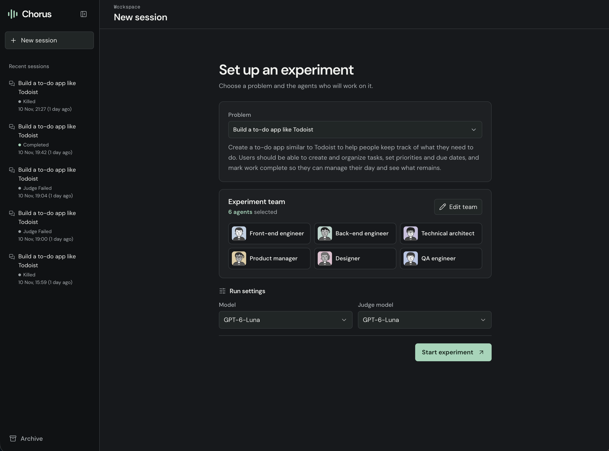

# Chorus

Chorus is a research harness that brings together swarms of AI agents with different personalities, roles, and perspectives to work on a shared problem statement. I created it to study how these differences shape collaboration: how agents divide work, share information, challenge each other, resolve disagreements, and reach decisions.

Through Chorus, I want to understand which tasks benefit from a team and which are better handled by one agent or several agents working independently. I’m interested in whether a swarm of smaller models can match a stronger model.

I also want to look beyond whether a team finishes a task. Does disagreement help agents discover a better answer, or do they settle too quickly on the first convincing idea? Do different personalities, roles, and sources of information help them catch each other’s mistakes? What happens when their goals conflict, or when one agent has evidence the others need?

The goal is to understand when collaboration produces better work, what makes it succeed or fail, and whether the improvement is worth the time and cost. By varying tasks and teams and repeating comparisons, I hope to build evidence about when agent swarms are useful, how they can be made more reliable, and when a simpler approach is enough.



*Choose a task, pick your team, and start an experiment.*

## What changed

Chorus and Chorus Web now live in this repository. One command starts the app:

```bash
chorus launch
```

The two parts still have separate jobs:

- **Chorus engine** runs the agents, calls models, checks actions, and saves records.
- **Chorus Web** is the browser interface for starting experiments and viewing their progress.
- **Nanoville** remains a separate repository. It connects to the Chorus engine and is not needed to run this app.

You no longer need a separate `chorus-web` checkout. The merge keeps existing session data and the same default ports. This is still an app you run from the source code; it is not a packaged desktop download.

## What you can do

### Build an app with a team

The web home page offers four briefs: build an app like Todoist, Linear, Notion, or Typeform.

Choose from ten agent roles. Six are selected to start, and you can change the team. Choose the model for the agents and, if you want, a different model for the final judge.

Each experiment has three stages:

1. **Plan:** The agents discuss the brief and write a shared plan and task lists in `SPEC.md`.
2. **Build:** Each agent edits its own working copy of the code. Agents submit changes, review them, and combine them into the shared project.
3. **Judge:** A model reviews the final saved code and the work records.

You can follow the discussion, read the plan, inspect code changes, and see each agent’s task progress. Unfinished tasks remain visible with explanations. **Kill experiment** stops the work and keeps its files and records. If judging fails, **Retry judge** reviews the same saved result.

App experiments need Git. Small frontend and backend starter projects are included. To use your own reviewed starter projects, set `CHORUS_EXPERIMENT_SCAFFOLD` in `.env` to a folder containing `frontend/` and `backend/`.

**Current limit:** agents can write and inspect code, but running application commands, starting the generated app, and checking it in a browser are not implemented in the experiment tools yet. The judge’s report is a code review, not proof that the generated app works.

### Run smaller problems with checked answers

The engine also includes five benchmark problems: scheduling, transaction records, mixtures, production planning, and probability. These are available through the command line and API; they are not the current web home page’s task picker.

These runs use a separate set of fifty agent profiles. You can choose 2–50 agents and set a turn limit for each one. Agents discuss the problem and write a shared answer. Code checks that answer against the problem’s rules. An optional model judge reviews the collaboration separately.

For example, with Chorus running:

```bash
chorus run production-mix --turns-per-agent 3
```

Command-line benchmark runs include the model judge by default. Add `--no-judge` to skip that review while keeping the answer checks.

## Run Chorus

Use macOS or Linux, Git, Python 3.11 or newer, and Node 24. On Windows, use WSL. Open a terminal in this repository.

### First-time setup

```bash
python3 -m pip install uv==0.9.8
uv sync --locked --extra dev
source .venv/bin/activate
cp -n .env.example .env
npm ci --prefix web
chorus doctor
```

If you use nvm to manage Node, run `nvm use` before the npm command. The repository includes the required Node version in `.nvmrc`.

Open `.env` and configure the model you want to use:

- `CHORUS_API_KEY` for GPT-6-Luna, the default model.
- `OPENROUTER_API_KEY` for models offered through OpenRouter.
- `OLLAMA_HOST` for local models served by Ollama.

Keep keys in the engine’s environment, not in the browser code. If the default model is unavailable, choose another configured model. Chorus does not switch models for you.

### Start the app

In a new terminal, activate the Python environment and make sure Node 24 is selected. Then launch:

```bash
source .venv/bin/activate
chorus launch
```

The command starts both parts and opens your browser:

- **App:** [http://127.0.0.1:43189](http://127.0.0.1:43189)
- **Engine:** [http://127.0.0.1:43187](http://127.0.0.1:43187)

Keep the terminal open. Press **Ctrl-C** to stop both parts. Closing the browser alone leaves the agents running.

If a port is already in use, stop the old service or choose other ports:

```bash
chorus launch --api-port 43287 --web-port 43289
```

Use `chorus launch --no-browser` if you do not want a browser tab to open.

### Use a built version

The default launcher uses development mode. To build the interface first and run that version:

```bash
npm run build --prefix web
chorus launch --production
```

Rebuild after changing the interface. You can still start the engine alone with `chorus serve`.

## Saved work

The sidebar lists saved runs. Reopen a run to inspect its discussion, tasks, changes, usage, and results. Older sessions remain available through the archive.

The default session database is `~/.local/share/chorus/sessions.sqlite3`. Set `CHORUS_DB` to use a different location. Run only one engine against a database at a time.

Generated app projects are saved in an `experiments/` folder beside the database by default. Set `CHORUS_EXPERIMENT_ROOT` to change that location. The merge does not move or erase these records or projects.

You can export the shared document as Markdown or the session records as JSON. Some private experiment records are hidden until the experiment completes or is killed. Usage totals keep reported costs, estimates, and missing information separate.

Save local exports under the ignored `exports/` folder. Do not commit experiment results, generated workspaces, databases, model files or recordings. Small test fixtures and documentation images remain in Git.

## Project files

- `chorus/` — engine, saved records, API, and command-line tools.
- `web/` — browser interface and its tests.
- `sdk/` — shared interface code and definitions of the data exchanged with the engine.
- `tests/` — engine tests.
- `docs/` — setup details, research notes, and test records.

The engine remains responsible for all model calls and execution rules. Moving the interface here does not move those responsibilities into the browser.

## Make changes

Run the checks from the repository root:

```bash
.venv/bin/python scripts/check.py
```

The shared check runs engine tests, coverage, code checks, generated-file checks, web checks, a dependency audit and repository size/output rules. For the first browser-test run, install Chromium from `web/` with `npx playwright install chromium`. Tests use temporary databases and fake model responses.

Shared files in `web/lib/api/chorus/` are generated copies. Edit their source in `sdk/`, then update the copies:

```bash
.venv/bin/python scripts/export_contracts.py
```

This uses the dependencies installed in `web/` and updates only this repository. To also update a separate Nanoville checkout:

```bash
.venv/bin/python scripts/export_contracts.py --nanoville ../nanoville
```

Run Nanoville’s checks there after exporting. Run the two apps’ browser test suites one after the other.

## More details

- [Contribution guide](CONTRIBUTING.md)
- [Agent instructions](AGENTS.md)
- [Security and private data](SECURITY.md)
- [Setup and commands](docs/running-chorus.md)
- [Web interface guide](web/README.md)
- [What moved in the merge](docs/repository-consolidation.md)
- [Research direction and design](docs/chorus-architecture.md)
- [Checks performed and known limits](TEST_PLAN.md)

Passing software tests does not establish how reliably a model or a large team will solve a task. Real experiment results stay outside this repository.

## License and citation

Chorus is licensed under [Apache 2.0](LICENSE). See [CITATION.cff](CITATION.cff) when citing the software; record the exact commit used for a study.
