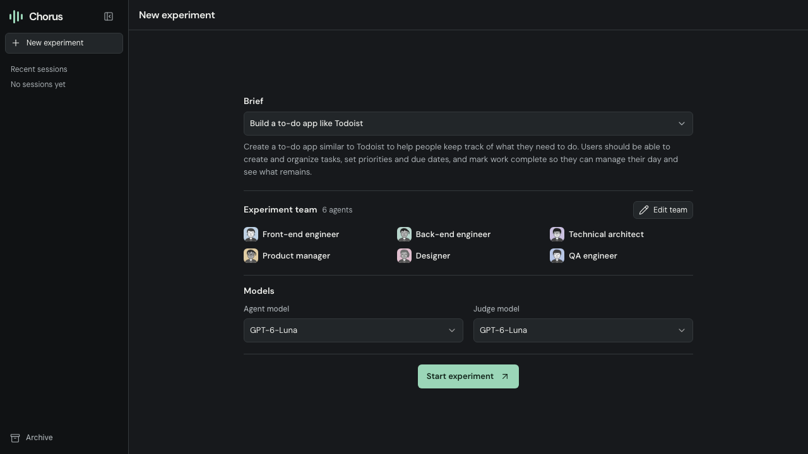

# Chorus

Chorus is a research harness that brings together swarms of AI agents with different personalities, roles, and perspectives to work on a shared problem statement. I created it to study how these differences shape collaboration: how agents divide work, share information, challenge each other, resolve disagreements, and reach decisions.

Through Chorus, I want to understand which tasks benefit from a team and which are better handled by one agent or several agents working independently. I’m interested in whether a swarm of smaller models can match a stronger model.

I also want to look beyond whether a team finishes a task. Does disagreement help agents discover a better answer, or do they settle too quickly on the first convincing idea? Do different personalities, roles, and sources of information help them catch each other’s mistakes? What happens when their goals conflict, or when one agent has evidence the others need?

The goal is to understand when collaboration produces better work, what makes it succeed or fail, and whether the improvement is worth the time and cost. By varying tasks and teams and repeating comparisons, I hope to build evidence about when agent swarms are useful, how they can be made more reliable, and when a simpler approach is enough.



*Choose a task, pick your team, and start an experiment.*

## How Chorus is organized

Chorus and Chorus Web live in this repository.

- **Chorus engine** runs the agents, calls models, checks actions, and saves records.
- **Chorus Web** is the browser interface for starting experiments and viewing their progress.
- **Nanoville** remains a separate repository. It connects to the Chorus engine and is not needed to run this app.

Compose builds the app from this checkout and keeps session data in a Docker volume. The source launcher is also available for development and existing local installations.

## What you can do

### Run a repository experiment with a team

The web home page offers four app briefs and **Other**. Choose **Other** to paste a custom problem statement, such as writing a sitcom pilot or planning a trip. Specify the format in the brief or let the team choose one during planning.

Choose from ten agent roles, with six selected to start. Or choose **Generate** to use the selected **Agent model** to create three to five agents for the brief, each with a distinct avatar and a role-specific prompt. Generation selects the new team. Use **Edit team** to remove agents or add catalog roles. You can choose a different model for the final judge.

Each experiment has three stages:

1. **Plan:** The agents discuss the brief and write a shared plan and task lists in `SPEC.md`.
2. **Build:** Each agent edits its own working copy of the repository. Agents submit changes, review them, and combine them into the shared project.
3. **Judge:** A model reviews the final committed work and the work records, including each agent’s contribution.

Custom experiments support text artifacts such as Markdown and HTML, as well as software changes. Results list the files checked at the final commit and let you open or download them. The plan and Results record requested outputs that require unavailable capabilities, such as image generation or live web research.

The dark, keyboard-first workspace keeps the Board beside `SPEC.md` when there’s room, and **Cmd+K** opens a command palette for runs, views, and actions. Open **Participants** to see active tasks and blockers, **Repository** to read source and diffs, or **Results** to trace scores to their evidence. With Compose running, **Browser** can start and preview a generated app, and **Terminal** opens a shell in the same temporary workspace. **Usage** shows model calls and costs, and **Archive** helps you find and reopen saved runs. [Chorus Web guide](web/README.md)

**Kill experiment** stops the work and keeps its files and records. If judging fails, **Retry judge** reviews the same saved result.

Small frontend and backend starter projects are included. You can also use reviewed custom starter projects. [Custom starter configuration](docs/running-chorus.md#start-an-app-experiment)

Browser and Terminal are user controls. Agents and judges work from code and saved evidence. Use **Run** to verify the generated app yourself.

### Compare Chorus agents on DeepSWE

In a source installation, configure Docker and Pier, set `CHORUS_DEEPSWE_PROFILE`, and calibrate the verifier. Set `CHORUS_DEEPSWE_PROFILES_DIR` to register additional calibrated task profiles. Choose **DeepSWE** in the home page’s problem-source dropdown, then select a task. The **App or open-ended problem** option offers the preset briefs and **Other** for your own statement. [Local verifier setup and calibration](docs/deep-swe-integration-plan.md#local-verifier-setup)

The launcher starts with the six default Chorus profiles. **Use solo vs. team preset** sets up one neutral worker and a team of three neutral workers, with three repeats per condition. To compare a solo worker with the six default profiles, duplicate the default condition first, then edit the first condition down to one worker and select **No personality or role**. Each condition has a team model, optional worker model overrides, a shared model-call limit and a solving deadline per trial.

Every trial starts from a fresh copy of the pinned repository. Once solving ends, the official verifier grades the merged patch. Its binary reward is **1** for a pass or **0** for a fail. The campaign’s **Resolution rate** is the percentage of graded trials that passed. **Inspect trial** shows the patch and any test counts the verifier returned. A verifier error leaves the trial ungraded and lets you retry the same patch.

You can close the browser while the engine runs. Reopen the report from **Saved campaigns** to see paired differences across repeats, model calls, elapsed time and costs. Use **Repeat campaign** to run the saved conditions again or **Export JSON** to download the report.

### Run smaller problems with checked answers

The engine also includes five benchmark problems: scheduling, transaction records, mixtures, production planning, and probability. These are available through the command line and API; they are not the current web home page’s task picker.

These runs use a separate set of fifty agent profiles. You can choose 2–50 agents and set a turn limit for each one. Agents discuss the problem and write a shared answer. Code checks that answer against the problem’s rules. An optional model judge reviews the collaboration separately.

For example, with the source launcher or API server running:

```bash
chorus run production-mix --turns-per-agent 3
```

Command-line benchmark runs include the model judge by default. Add `--no-judge` to skip that review while keeping the answer checks.

## Run Chorus

Install Docker with Compose, then open a terminal in this repository:

```bash
cp -n .env.example .env
docker compose up -d --build --wait
```

Open [http://127.0.0.1:43189](http://127.0.0.1:43189). Run `docker compose stop` to shut down the stack, or `docker compose down` to remove the containers and keep saved experiments. Configure provider keys in `.env`, or set `CHORUS_DOCKER_OLLAMA_HOST` to reach a local Ollama server. [Docker commands and data migration](docs/running-chorus.md#start-with-docker-compose)

### Run from source

For source development, use macOS or Linux, Git, Python 3.11 or newer, and Node 24. On Windows, use WSL.

#### First-time setup

```bash
python3 -m pip install uv==0.9.8
uv sync --locked --extra dev
source .venv/bin/activate
cp -n .env.example .env
npm ci --prefix web
chorus doctor
```

If you use nvm to manage Node, run `nvm use` before the npm command. The repository includes the required Node version in `.nvmrc`.

Open `.env` and configure the model you want to use:

- `CHORUS_API_KEY` for GPT-6-Luna (default), GPT-6.1 Terra, and GPT-6.2 Sol.
- `OPENROUTER_API_KEY` for models offered through OpenRouter.
- `OLLAMA_HOST` for local models served by Ollama.

Keep keys in the engine’s environment, not in the browser code. If the default model is unavailable, choose another configured model. Chorus does not switch models for you.

#### Start the app

In a new terminal, activate the Python environment and make sure Node 24 is selected. Then launch:

```bash
source .venv/bin/activate
chorus launch
```

The command starts both parts and opens your browser:

- **App:** [http://127.0.0.1:43189](http://127.0.0.1:43189)
- **Engine:** [http://127.0.0.1:43187](http://127.0.0.1:43187)

Keep the terminal open. Press **Ctrl-C** or run `chorus stop` from another terminal to stop both parts. Closing the browser alone leaves the agents running.

If a port is already in use, stop the old service or choose other ports:

```bash
chorus launch --api-port 43287 --web-port 43289
```

Use `chorus launch --no-browser` if you do not want a browser tab to open.

#### Use a built version

The default launcher uses development mode. To build the interface first and run that version:

```bash
npm run build --prefix web
chorus launch --production
```

Rebuild after changing the interface. You can still start the engine alone with `chorus serve`.

## Saved work

The sidebar lists saved runs. Reopen a run to inspect its discussion, tasks, changes, usage, and results. Older sessions remain available through the archive.

Compose stores sessions and generated Git repositories together in `chorus_work` for the default project. Stopping, rebuilding, or recreating containers keeps that volume. Each named Compose project has its own volume. Browser and Terminal scratch files are temporary and are discarded when their controller stops.

A source installation defaults to `~/.local/share/chorus/sessions.sqlite3` with an `experiments/` directory alongside it. Set `CHORUS_DB` and `CHORUS_EXPERIMENT_ROOT` to override those source paths. Run only one engine against a database at a time. [Open existing data in Docker](docs/running-chorus.md#open-data-from-a-source-installation)

You can export the shared document as Markdown or the session records as JSON. Some private experiment records are hidden until the experiment completes or is killed. Usage totals keep reported costs, estimates, and missing information separate.

Save local exports under the ignored `exports/` folder. Do not commit experiment results, generated workspaces, databases, model files or recordings. Small test fixtures and documentation images remain in Git.

## Project files

- `chorus/` — engine, saved records, API, and command-line tools.
- `web/` — browser interface and its tests.
- `sdk/` — shared interface code and definitions of the data exchanged with the engine.
- `tests/` — engine tests.
- `docs/` — setup details, research notes, and test records.

The engine remains responsible for all model calls and execution rules. Moving the interface here does not move those responsibilities into the browser.

## Make changes

Run the checks from the repository root:

```bash
.venv/bin/python scripts/check.py
```

The shared check runs engine tests, coverage, code checks, generated-file checks, web checks, a dependency audit and repository size/output rules. For the first browser-test run, install Chromium from `web/` with `npx playwright install chromium`. Tests use temporary databases and fake model responses. A separate Docker suite exercises real preview and terminal containers in Chromium and WebKit. [Docker test instructions](TEST_PLAN.md#check-real-docker-workspaces)

Shared files in `web/lib/api/chorus/` are generated copies. Edit their source in `sdk/`, then update the copies:

```bash
.venv/bin/python scripts/export_contracts.py
```

This uses the dependencies installed in `web/` and updates only this repository. To also update a separate Nanoville checkout:

```bash
.venv/bin/python scripts/export_contracts.py --nanoville ../nanoville
```

Run Nanoville’s checks there after exporting. Run the two apps’ browser test suites one after the other.

## More details

- [Contribution guide](CONTRIBUTING.md)
- [Agent instructions](AGENTS.md)
- [Security and private data](SECURITY.md)
- [Setup and commands](docs/running-chorus.md)
- [Web interface guide](web/README.md)
- [What moved in the merge](docs/repository-consolidation.md)
- [Research direction and design](docs/chorus-architecture.md)
- [Checks performed and known limits](TEST_PLAN.md)

Passing software tests does not establish how reliably a model or a large team will solve a task. Real experiment results stay outside this repository.

## License and citation

Chorus is licensed under [Apache 2.0](LICENSE). See [CITATION.cff](CITATION.cff) when citing the software; record the exact commit used for a study.
