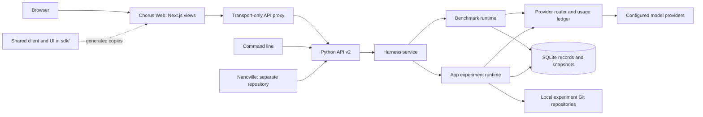
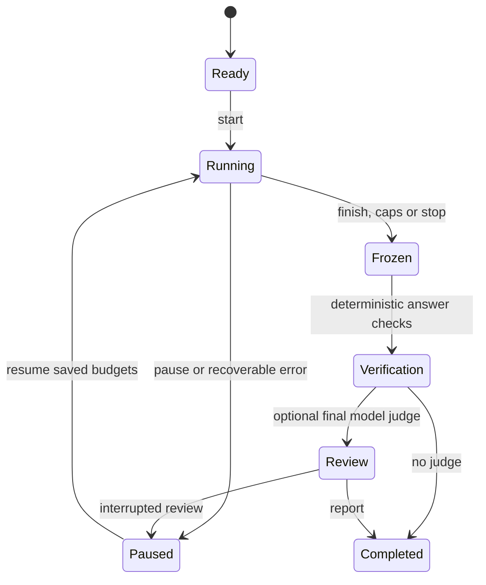

# Chorus architecture

Updated 11 November 2026. This describes the current application. Earlier research/design notes are [archived](archive/architecture-v1.md).

## One repository, separate responsibilities

`chorus launch` supervises one Python API and one web process. Defaults remain 43187 and 43189. Nanoville is a separate API consumer on its own port and is not required. The web owns display and input; the engine owns models, prompts, permissions, execution, storage, usage and evaluation.

`chorus/harness/` is current execution code. `chorus/services/` also contains the older engine, and `/api/v1` remains readable for historical sessions; production legacy writes are disabled. Do not infer current behavior from old templates or catalogs.

## Two kinds of run

### App experiments

The web home page creates app experiments: four briefs and ten roles, with six selected initially. The engine copies the bundled or explicitly configured frontend/backend starter into an isolated Git repository and assigns worktrees.

```mermaid
stateDiagram-v2
    [*] --> Plan
    Plan --> Build: all planners complete
    Build --> Judge: workers finish or fail; freeze evidence
    Judge --> Completed: validated report
    Judge --> JudgeFailed: incomplete or invalid review
    JudgeFailed --> Judge: retry frozen result
    Plan --> Interrupted: interruption or restart
    Build --> Interrupted: interruption or restart
    Interrupted --> Plan: resume planning
    Interrupted --> Build: resume building
    Plan --> Killed: kill
    Build --> Killed: kill
    Judge --> Killed: kill
```

`SPEC.md` is authoritative shared planning/task state. Agents edit code in their assigned worktrees, create local PR records and merge reviewed contributions into the primary branch. These are local operations, not GitHub pull requests. Tool permissions depend on actor and phase. Git operations disable external hooks/configuration and validate paths/branch identity.

The final judge reads frozen evidence and code; it cannot build or run the application. Its review is not a deterministic correctness result. App workers currently have no overall call/time/spend limit; operational limits are planned separately from completion rules.

### Benchmarks

Five checked problems use a separate catalog of fifty personas and 2–50 selected agents. They are available through CLI/API and saved-session views.

Workers run independently with per-agent turn/call/tool budgets. Board posts and accepted canvas edits commit independently. The shared canvas requires a fenced exclusive lease. A model judge cannot overrule the deterministic answer checker. Do not apply these benchmark turn limits to app experiments.

## Data and live updates

Pydantic models define contracts; `scripts/export_contracts.py` generates JSON Schema, OpenAPI and TypeScript and copies shared client/UI files into `web/`. `--check` detects drift without rewriting files. Nanoville export is explicit. Runtime client validation rejects unexpected response shapes, including errors defined in `chorus/error_codes.py`.

Each session has a current snapshot/revision and ordered durable records. Commands carry an ID and expected revision. Workers publish against cancellation generations; stale cancelled work cannot publish. SQLite writes are serialized within one process; run only one engine per database. Model calls stay outside database transactions.

The browser subscribes to server-sent snapshot events. Reconnection uses the latest revision; intermediate snapshots may be skipped. Separate record cursors retain the audit history. Closing a tab does not stop agents. Storage currently writes full revision snapshots and several views reread large record sets; measure before changing retention or optimizing.

Default data is outside the checkout at `~/.local/share/chorus/`. The database and sibling `experiments/` directory together form saved work. Never commit either, nor real exports or test recordings.

## Visibility and measurement

Model keys remain in the engine. Author-only stated summaries, observer records and model context have separate visibility rules; provider-private reasoning is never requested or stored. App conversation/tool/request/output/summary records are hidden by the API during active runs and exposed after completion or kill. Judges read a frozen evidence boundary. Historical journals remain observer-only.

Every dispatched attempt is metered, including retries, failure, cancellation and judging. Keep reported/estimated costs and covered/unknown values distinct. Saved versions and problem/persona snapshots help interpret runs; live model calls are not guaranteed to reproduce byte for byte.

## Changes and recovery

Preserve engine/prompt version checks and historical readability. Execution changes need the relevant version bump and a documented recovery path. New starters apply only to new experiments; existing workspaces are not replaced. Starter import hardening does not change an existing run's scheduler or prompts.

Use [AGENTS.md](../AGENTS.md) for invariants, [CONTRIBUTING.md](../CONTRIBUTING.md) for extension recipes, [SECURITY.md](../SECURITY.md) for trust boundaries, and [running Chorus](running-chorus.md) for configuration and backup.
