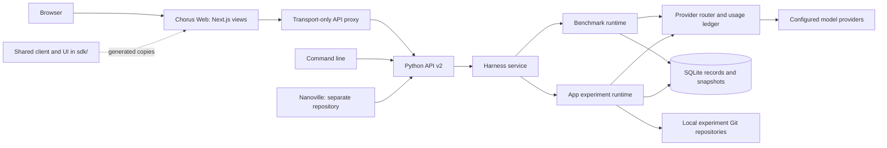
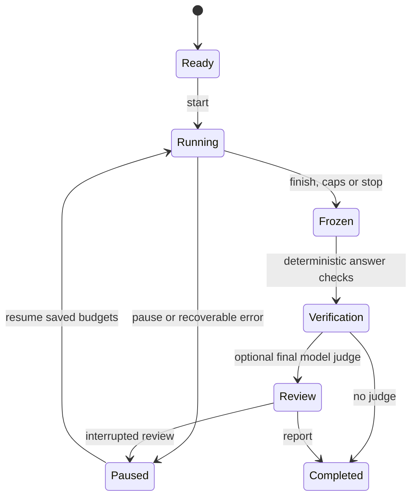

# Chorus architecture

Updated 24 November 2026. This describes the current application. Earlier research/design notes are [archived](archive/architecture-v1.md).

## One repository, separate responsibilities

`chorus launch` supervises one Python API and one web process. Defaults remain 43187 and 43189. Nanoville is a separate API consumer on its own port and is not required. The web owns display and input; the engine owns models, prompts, permissions, execution, storage, usage and evaluation.

Under Compose, one app container supervises the production Next.js web process and one Python engine, with SQLite and experiment repositories in a persistent volume. The engine stays on container loopback. A separate controller serves previews on host loopback and receives control requests over a private Unix socket. Only the controller has the Docker daemon socket. [Container startup and volumes](running-chorus.md#start-with-docker-compose)

`chorus/harness/` is current execution code. `chorus/services/` also contains the older engine, and `/api/v1` remains readable for historical sessions; production legacy writes are disabled. Do not infer current behavior from old templates or catalogs.

## Run types

### App experiments

The web home page creates repository experiments with four app briefs and an **Other** option for a custom problem statement. There are ten roles, with six selected initially. The engine copies the bundled or explicitly configured frontend/backend starter into an isolated Git repository and assigns worktrees.

```mermaid
stateDiagram-v2
    [*] --> Plan
    Plan --> Build: all planners complete
    Build --> Judge: workers finish or fail; freeze evidence
    Judge --> Completed: validated report
    Judge --> JudgeFailed: incomplete or invalid review
    JudgeFailed --> Judge: retry frozen result
    Plan --> Interrupted: interruption or restart
    Build --> Interrupted: interruption or restart
    Interrupted --> Plan: resume planning
    Interrupted --> Build: resume building
    Plan --> Killed: kill
    Build --> Killed: kill
    Judge --> Killed: kill
```

`SPEC.md` is authoritative shared planning/task state. Agents edit code in their assigned worktrees, create local PR records and merge reviewed contributions into the primary branch. These are local operations, not GitHub pull requests. Tool permissions depend on actor and phase. Git operations disable external hooks/configuration and validate paths/branch identity.

The final judge reads frozen evidence and code; it cannot build or run the application. Its review is not a deterministic correctness result. App workers currently have no overall call/time/spend limit; operational limits are planned separately from completion rules.

**Run** and **Terminal** are user operations. The engine exports regular committed blobs from the selected `main` revision into a disposable container without Git metadata. The container shares neither the experiment checkout nor credentials. Its loopback network lets the frontend and backend communicate. The controller relays registered HTTP and WebSocket ports and exposes one short-lived, origin-bound terminal ticket at a time. Each forwarded port gets a distinct browser origin. The iframe wrapper uses same-origin browser history inside the preview and exchanges navigation messages with Chorus. Run logs and terminal I/O remain transient.

Custom runs snapshot the full user brief and publish a typed deliverable plan through the same SPEC lease. Build can write UTF-8 artifacts under `deliverables/`, in addition to the existing starter paths. The last planning completion locks the plan, and freeze checks its declared outputs against the committed `main` tree. Artifact downloads and the deliverable rubric use that same commit. Individual and collaboration scorecards retain their existing criteria. Custom runs use `experiment-v5-custom` and `experiment-v5-custom-deliverables`. Preset runs retain the `experiment-v4` runtime, saved-run recovery, and application rubric.

The **Generate** setup action calls the selected Agent model once and validates three to five profiles for the current brief. Chorus stores the profiles and generation usage in a setup record keyed to the brief. Launch snapshots only the selected profiles and includes the generation call in session usage. Generated teams use `experiment-v6-generated-team` and `experiment-v6-generated-personas`. Plan and Build receive the saved role guidance under the harness's phase instructions, and the brief still selects the rubric. Existing catalog-only runs keep their original prompts and version checks.

### Benchmarks

Five checked problems use a separate catalog of fifty personas and 2–50 selected agents. They are available through CLI/API and saved-session views.

Workers run independently with per-agent turn/call/tool budgets. Board posts and accepted canvas edits commit independently. The shared canvas requires a fenced exclusive lease. A model judge cannot overrule the deterministic answer checker. Do not apply these benchmark turn limits to app experiments.

### DeepSWE repository benchmarks

The source launcher offers locally registered DeepSWE repository tasks. Each trial has a fresh Git workspace, a shared call limit and deadline, an integrated patch, and a binary verifier reward. Configurable runs use `deepswe-v5`. A numbered worker slot owns its worktree and binds a model and guidance mode. An empty-body session request uses the default task and fixed team (`deepswe-v5-fixed-team`).

During Build, workers can inspect their Git status and read a file at a merged main revision. Finishing requires a clean worktree, completed Git synchronization and a branch tip already integrated into main. A reviewer can finish without contributing a patch. The call limit and deadline still freeze the current main. Historical v1–v4 scores and frozen patches remain available, including retries of failed verification. Resuming an older unfinished solving campaign requires its original engine and prompt versions.

Each trial starts with the pinned repository and public task statement. Solver context is confined to the current session. Grading begins after the submission is frozen. Version 4 included task-specific feedback during solving and should be identified separately in comparisons.

After Build, the engine freezes the submitted Git tree and patch digest. The Pier adapter replays the patch against the pinned base and checks the collected artifact against the submitted tree. A separate Docker verifier built from the upstream test files grades it. Submission errors and missing grades produce a retryable verification failure. Retry reads the original patch. New results include a bounded compiler diagnostic when Jest reports a suite failed to start.

The web launcher creates a campaign even for one trial. SQLite migration 5 adds its manifest, frozen rosters, version pins and trial slots. Each slot acquires its session ID in the same transaction that creates the session. The Python campaign service runs conditions in seeded repeat blocks, one trial at a time per campaign. Restart pauses unfinished campaigns for explicit resume. Reports recompute scores from accepted rewards, count ungraded slots separately and compare only matched repeats on compatible task and verifier pins. [DeepSWE setup and reproducibility guide](deep-swe-integration-plan.md)

## Data and live updates

Opted-in repository experiments pin a public check profile and use the `+public-checks-v1` execution and prompt suffix. A Build agent requests a configured check against a full `main` SHA. A disposable offline runner receives only committed regular files and returns bounded text and exit status. The `public_check` records associate a request and outcome with that commit and its author. A newer merge is unchecked until a worker asks for a check. Interruption settles outstanding requests as cancelled, and resuming requires a fresh agent request. Freeze records the latest outcomes for the submitted SHA. Campaign conditions record whether they used the capability and pin its profile. Saved sessions without the capability retain their original versions and recovery behavior. [Public check setup](running-chorus.md#enable-agent-requested-public-checks)

Pydantic models define contracts; `scripts/export_contracts.py` generates JSON Schema, OpenAPI and TypeScript and copies shared client/UI files into `web/`. `--check` detects drift without rewriting files. Nanoville export is explicit. Runtime client validation rejects unexpected response shapes, including errors defined in `chorus/error_codes.py`.

Each session has a current snapshot/revision and ordered durable records. Commands carry an ID and expected revision. Workers publish against cancellation generations; stale cancelled work cannot publish. SQLite writes are serialized within one process; run only one engine per database. Model calls stay outside database transactions.

The browser subscribes to server-sent snapshot events. Reconnection uses the latest revision; intermediate snapshots may be skipped. Separate record cursors retain the audit history. Closing a tab does not stop agents. Storage currently writes full revision snapshots and several views reread large record sets; measure before changing retention or optimizing.

Compose saves data in the project's `work` volume. A source installation defaults to `~/.local/share/chorus/`. The database and sibling `experiments/` directory together form saved work. Keep both outside Git along with real exports and test recordings.

## Visibility and measurement

Model keys remain in the engine. Author-only stated summaries, observer records and model context have separate visibility rules; provider-private reasoning is never requested or stored. App conversation/tool/request/output/summary records are hidden by the API during active runs and exposed after completion or kill. Judges read a frozen evidence boundary. Historical journals remain observer-only.

Every dispatched attempt is metered, including retries, failure, cancellation and judging. Keep reported/estimated costs and covered/unknown values distinct. Saved versions and problem/persona snapshots help interpret runs; live model calls are not guaranteed to reproduce byte for byte.

## Changes and recovery

Preserve engine/prompt version checks and historical readability. Execution changes need the relevant version bump and a documented recovery path. New starters apply only to new experiments; existing workspaces are not replaced. Starter import hardening does not change an existing run's scheduler or prompts.

Use [AGENTS.md](../AGENTS.md) for invariants, [CONTRIBUTING.md](../CONTRIBUTING.md) for extension recipes, [SECURITY.md](../SECURITY.md) for trust boundaries, and [running Chorus](running-chorus.md) for configuration and backup.
