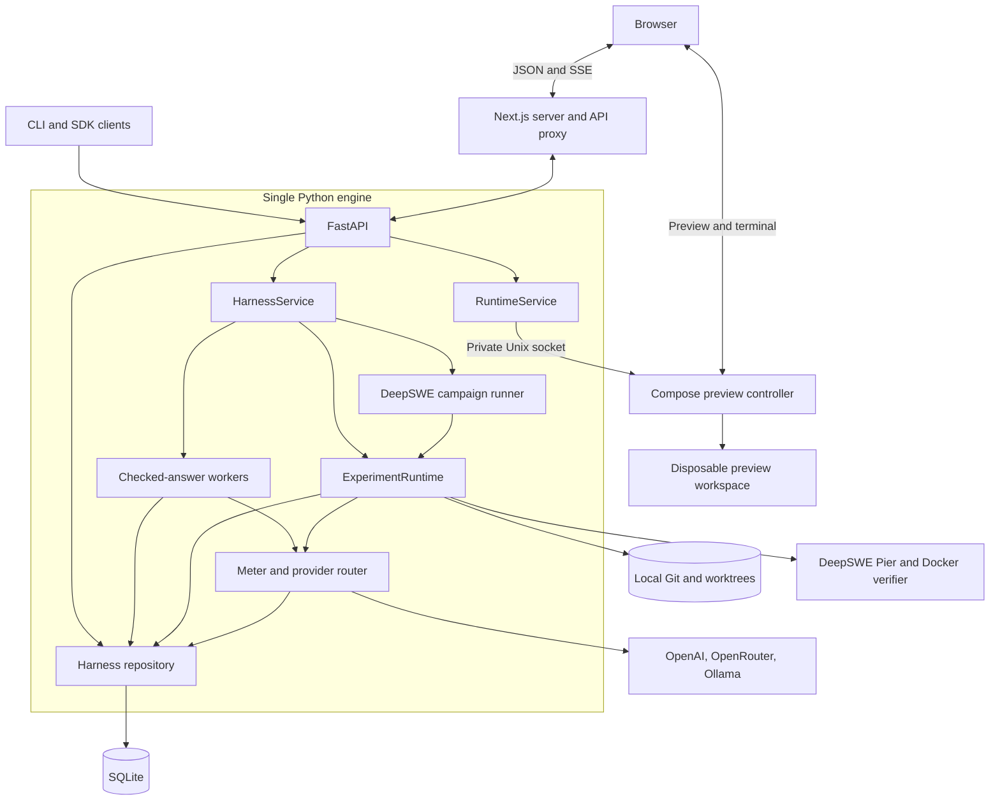
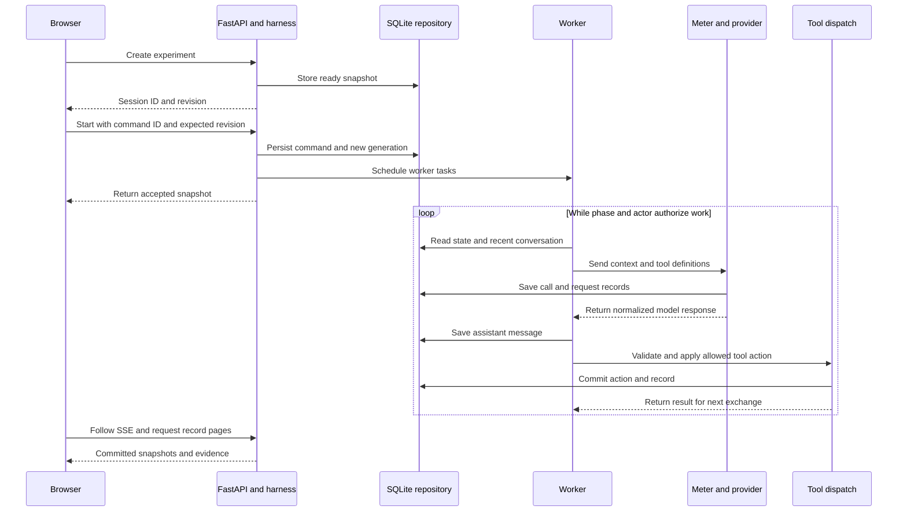
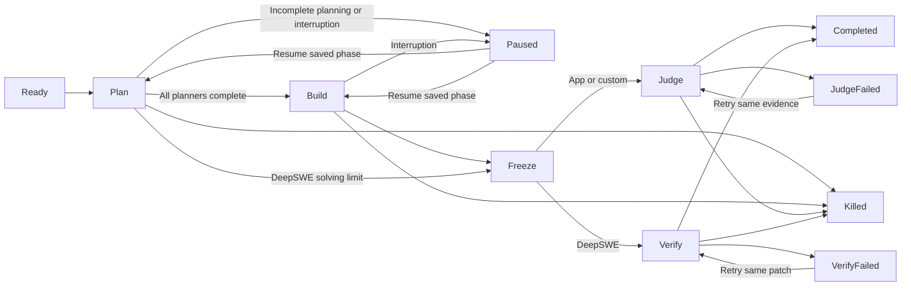
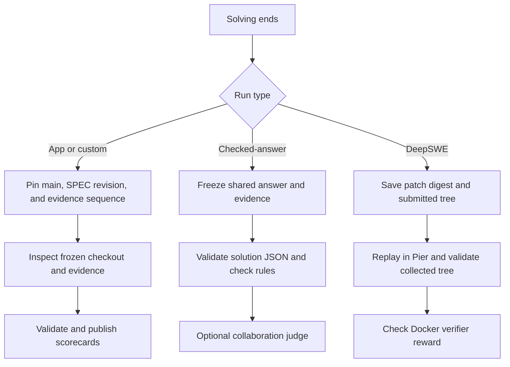
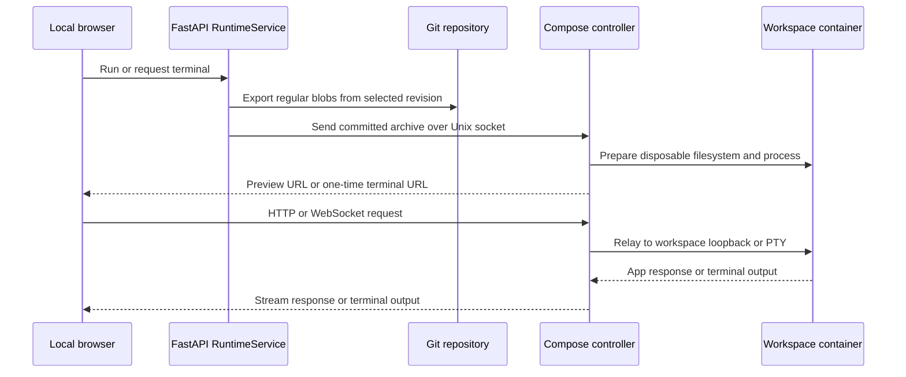

# Chorus user manual and technical reference

**Source baseline:** Chorus 0.2.0, commit `a861743` · **Documentation date:** 25 November 2026

Chorus is a local research harness for observing how AI agents coordinate around a shared problem. It can build a repository from a brief, solve bounded problems whose answers can be checked in code, or evaluate repository patches against a pinned DeepSWE verifier. Each run preserves the inputs, interaction records, and outcome needed to inspect how the result was produced.

## Contents

1. [Choose a workflow](#1-choose-a-workflow)
2. [Install and run Chorus](#2-install-and-run-chorus)
3. [Run an app or custom experiment](#3-run-an-app-or-custom-experiment)
4. [Inspect runs and execute generated apps](#4-inspect-runs-and-execute-generated-apps)
5. [Run checked-answer benchmarks](#5-run-checked-answer-benchmarks)
6. [Run and compare DeepSWE trials](#6-run-and-compare-deepswe-trials)
7. [Architecture and implementation](#7-architecture-and-implementation)
8. [CLI, HTTP API, and SDK reference](#8-cli-http-api-and-sdk-reference)
9. [Configuration, operations, and security](#9-configuration-operations-and-security)
10. [Develop, test, and extend Chorus](#10-develop-test-and-extend-chorus)
11. [Troubleshooting](#11-troubleshooting)
12. [File map and glossary](#12-file-map-and-glossary)

## 1. Choose a workflow

| Workflow | Entry point | Work product | Evaluation |
| --- | --- | --- | --- |
| Preset app experiment | Web home → **App or open-ended problem** | Integrated Git repository based on a starter | Required model review of frozen code and evidence |
| Custom experiment | Same source → **Other** | Repository changes or planned UTF-8 files under `deliverables/` | Required model review plus committed artifact checks |
| Checked-answer benchmark | `chorus run` or `POST /api/v2/sessions` | Shared Markdown canvas containing structured JSON | Deterministic checker and optional model collaboration review |
| DeepSWE trial or campaign | Web home → **DeepSWE**, or v2 API | Patch against a pinned repository base | Binary Docker verifier reward for the frozen patch |
| Historical session | **Archive**, saved session URL, or `/api/v1` | Previously saved conversation, canvas, and journals | Historical outcome as saved |

An **agent** is a configured role or persona. A **worker** is that participant's execution state within a session. A **judge** is a model with evidence-reading tools. A **verifier** is an executable check with its own inputs and result contract. An **observer** is the person using the interface or API to inspect the run.

## 2. Install and run Chorus

Run commands from the repository root unless a command explicitly changes directories. Docker Compose provides the integrated Browser and Terminal runtime. Source installs are the development path and the supported setup for the local DeepSWE verifier. An API-only source process is sufficient for CLI or HTTP clients. [Setup reference](running-chorus.md)

### Docker Compose

Start Docker Desktop on macOS or Docker Engine with Compose on Linux. Copy the configuration template, add the credentials for your selected model to the local `.env`, and start the stack.

```bash
cp -n .env.example .env
docker compose up -d --build --wait
docker compose ps -a
```

Open [Chorus on port 43189](http://127.0.0.1:43189). The engine binds port 43187 on loopback **inside** the app container. The preview controller is published on host loopback at 43192. The `workspace-image` service is a build dependency that exits successfully. If a host port is occupied, set `CHORUS_WEB_PORT` or `CHORUS_PREVIEW_PORT` before bringing up the stack.

```bash
docker compose logs -f chorus controller
docker compose stop
docker compose start
# Remove containers and the project network, keeping named volumes.
docker compose down
```

Keep the same Docker context and Compose project name to reopen saved work. `docker compose down --volumes` deletes the project's saved volume, including its database and repositories. Use a separate named project and distinct host ports for an isolated stack.

### Source installation

Requirements are macOS or Linux, Git, Python 3.11 or newer, and Node 24. Use WSL on Windows. The project pins uv for reproducible setup.

```bash
python3 -m pip install uv==0.9.8
uv sync --locked --extra dev
source .venv/bin/activate
cp -n .env.example .env
nvm use                           # Or select Node 24 with your Node manager.
npm ci --prefix web
chorus doctor
chorus launch
```

`chorus doctor` inspects local tools, dependencies and starter availability. It makes no model calls. `chorus launch` supervises the Python API and web server, checks readiness, and opens the browser. Use Ctrl-C in the launcher terminal or `chorus stop` from the same checkout to stop both. A running launcher owns its ports and database. Closing the browser leaves execution running.

```bash
chorus launch --no-browser --api-port 43287 --web-port 43289

# In a separate invocation, build and serve the production interface.
npm run build --prefix web
chorus launch --production --no-browser
```

To run the components separately, start `chorus serve --port 43187` in one terminal and `npm run dev --prefix web` in another. Set the web server's `CHORUS_API_URL` before starting it if your API uses a different port. Set the CLI's environment variable separately when pointing its commands at a nondefault port. [Launcher](../chorus/cli/launcher.py)

```bash
curl -fsS http://127.0.0.1:43187/health
curl -fsS http://127.0.0.1:43189/api/chorus/v2/sessions
```

The first check targets a source engine. The second targets the web proxy and works with the default source and Compose setups.

### Configure a model

| Provider group | Engine configuration | Model identifiers in this checkout |
| --- | --- | --- |
| OpenAI | `CHORUS_API_KEY` | `gpt-6-luna`, the default |
| OpenRouter | `OPENROUTER_API_KEY` | `deepseek/deepseek-v4.1-flash-1017`, `minimax/minimax-m3.1-flash`, `z-ai/glm-5.3-flash` |
| Ollama | `OLLAMA_HOST` and an installed catalog model | `qwen3.5:0.8b-mlx`, `qwen3.5:4b-mlx` |

Use the catalog to see what your installation exposes. Cloud availability in the catalog indicates configured credentials. Authentication, quota and service failures can still occur on dispatch. Ollama availability depends on reaching its model list and finding the exact model ID. In Compose, configure `CHORUS_DOCKER_OLLAMA_HOST` for the URL reachable from inside the app container. The default is `http://host.docker.internal:11434`. On Linux, the Ollama listener and firewall must allow the local Docker bridge to reach it. The engine honors the selected model and provider. [Catalog data](../chorus/harness/catalog.json) · [Provider router](../chorus/llm/providers.py)

```bash
chorus catalog --kind models
curl -fsS http://127.0.0.1:43189/api/chorus/v2/experiments/catalog
```

## 3. Run an app or custom experiment

1. Open the home page and select **App or open-ended problem**.
2. Pick the Todoist-style task list, Linear-style project tracker, Notion-style workspace, or Typeform-style form builder. Choose **Other** to supply your own brief.
3. Open **Edit team** to choose participants. Six roles are selected initially.
4. Choose the **Agent model** and the **Judge model**. Omitting the judge model in the API uses the agent model.
5. Select **Start experiment** and watch **Plan**, **Build**, then **Judge**. Plan completes when every selected participant calls `plan_complete`. Build combines contributions using local PRs and freezes the committed result. Judge reads that frozen result and publishes scorecards.

| Role | ID | Selected by default |
| --- | --- | --- |
| Front-end engineer | `frontend-engineer` | Yes |
| Back-end engineer | `backend-engineer` | Yes |
| Full-stack engineer | `fullstack-engineer` | |
| Technical architect | `technical-architect` | Yes |
| Product manager | `product-manager` | Yes |
| Project manager | `project-manager` | |
| Designer | `designer` | Yes |
| QA engineer | `qa-engineer` | Yes |
| Platform engineer | `platform-engineer` | |
| General agent | `general-agent` | |

The API accepts 1–15 distinct participants, including selected generated profiles. The four preset IDs are `todoist`, `linear`, `notion`, and `typeform`. [App catalog](../chorus/harness/experiment_catalog.py) · [Create contract](../chorus/harness/models.py)

### Write a custom brief

Provide the goal, constraints, and an observable deliverable. The backend accepts up to **12,000 UTF-8 bytes** and preserves the complete submitted statement in the session. This example asks for a deployment checklist.

```text
Produce a deployment readiness checklist for a small team's internal web app.
Primary output: deliverables/readiness-checklist.md in Markdown.
Cover rollbacks, database backups, smoke checks, owners, and escalation.
Use the supplied context only. List unknowns and assumptions explicitly.
```

During Plan, participants publish a typed deliverable plan with the outputs, acceptance criteria, and assumptions. There must be exactly one required primary output. The contract permits up to eight outputs and criteria, and up to six assumptions. Output kinds are `file`, `repository`, and `unavailable`. Use `deliverables/` for standalone files. The contract also accepts explicit file paths within `frontend/` and `backend/`. Paths must be distinct and cannot overlap as file and parent directory. The serialized plan limit is 4,500 bytes. Unsupported formats can be recorded as unavailable. The final checks classify each planned output as `ready`, `missing`, `invalid`, or `unavailable`. A ready file is downloadable from the frozen commit. A file must be new or changed since the baseline, regular, nonempty UTF-8, at most 120,000 bytes, and syntactically valid JSON when its extension is `.json`. A repository output is ready when the committed frontend or backend differs from the baseline. The judge assesses content quality separately. [Deliverable contract](../chorus/harness/models.py) · [Artifact checks](../chorus/harness/experiment_git.py)

### Generate roles for the brief

**Generate** calls the current Agent model once and returns three to five validated profiles for the selected brief. Pick the profiles you want to use before launching. The setup record binds profiles to the brief by its content hash. If you change the brief, generate a new team for the updated statement. The launched session snapshots selected generated profiles and includes the generation call in usage when at least one generated profile is used. The role text guides contributions within the existing phase permissions. [Team generation](../chorus/harness/experiment_team.py)

### Use your own starter

The default starter contains small Node projects at `frontend/` and `backend/`. To import a local starter, set `CHORUS_EXPERIMENT_SCAFFOLD` to the directory containing those two project roots. With Compose, mount the reviewed starter read-only into `chorus` and set the in-container path in that service.

```yaml
# Example compose.override.yaml
services:
  chorus:
    environment:
      CHORUS_EXPERIMENT_SCAFFOLD: /starters
    volumes:
      - /absolute/path/to/reviewed-starters:/starters:ro
```

The importer rejects symlinks and special files, excludes common credential and generated files, and enforces 5 MiB per file and 50 MiB per project. Review ordinary source files for embedded secrets before import. Changing the starter affects newly created experiments. Each existing experiment keeps its captured baseline. [Starter implementation](../chorus/harness/experiment_git.py) · [Bundled starters](../chorus/harness/starters/README.md)

## 4. Inspect runs and execute generated apps

### Follow the live workspace

| Area | What to look for |
| --- | --- |
| **Board** | Chronological discussion, dependencies and handoffs. **New posts** jumps forward without overriding your reading position. |
| **SPEC.md** or **Canvas** | Shared document. Repository experiments have owner-filtered **Tasks** and revision **Changes**. Benchmarks use the canvas for the checked answer. |
| **Participants** | Current task, brief status, checklist, remaining work, profile, and usage. Inspect **Needs attention** for blocked or failed agents. Reflections for repository runs become visible after completion or kill. |
| **Repository** | Files and commit diffs for `main` or selected agent branches. The branch picker shows committed work. Markdown opens in **Preview**, and **Raw** shows its source. |
| **Usage** | Total, participant, judge, and per-agent usage. Generated setup usage is shown when attached to the run. |
| **Results** | Outcome, judge report or verifier reward, evidence references, and downloadable outputs when available. |
| **Browser** and **Terminal** | User-controlled execution from a committed app revision through the Compose controller. |
| **Archive** | Saved runs by name or ID, with type and status filters. Historical sessions show the original conversation, canvas, and export. |

The sidebar and session URL reopen saved runs. Switching sessions or closing the tab leaves background work running. **Kill experiment** stops repository solving or evaluation and keeps committed files and records. **Retry judge** or **Retry verification** reuses the frozen inputs after a failed review. Use session exports for inspection and backup the data directory for restoration. [Web workflow](../web/README.md) · [Run controls](../web/components/harness/live.tsx)

### Run a committed app in Compose

1. Open **Browser** in an app experiment and choose **Run**. Chorus prepares a workspace from the available committed revision. It starts the backend on workspace port 3001, waits for it, then starts the frontend on 3000.
2. Watch **Service logs** if startup fails. The launcher expects an npm `dev` or `start` script for each project. When a project declares dependencies, it runs `npm ci` with a lockfile or `npm install --no-package-lock` without one. It uses the workspace registry relay to retrieve packages. Startup supplies `PORT`, `HOST=127.0.0.1`, and `BACKEND_URL=http://127.0.0.1:3001` to the managed scripts.
3. Use the address bar and navigation buttons to inspect the selected forwarded service. **Open in new tab** helps with pages that require a standalone browsing context.
4. Use **Stop** to stop managed processes while keeping temporary files. **Reset workspace** or **Load latest commit** discards the workspace and its scratch edits. Confirm which commit the panel shows before interpreting what you see.

The available revision tracks committed `main` until a result freezes. A prepared workspace remains pinned until reset. Work that exists only in a worker's branch or a terminal scratch directory is outside the committed preview revision. [Browser instructions](../web/README.md#run-the-generated-app) · [Node runner](../chorus/runtime/runner.py)

### Start a custom preview command

Open **Terminal**, run a process from `/workspace`, enter its port under **Workspace port**, and select **Forward port**. The following serves the checked-out frontend as static files for a simple inspection.

```bash
cd /workspace/frontend
python3 -m http.server 8080 --bind 127.0.0.1
```

Forward port `8080` and open its Browser URL. The image includes Bash, Git, Node/npm, and Python. The workspace has its own loopback and registry access for npm dependencies. Scratch files, terminal output and service logs are temporary. The Terminal can reconnect to an existing shell within its retention window, normally five minutes. A WebSocket connection ticket is single-use. A reconnect requests a new ticket. [Terminal implementation](../chorus/runtime/terminal.py) · [Workspace implementation](../chorus/runtime/workspace.py)

## 5. Run checked-answer benchmarks

The checked-answer catalog contains 50 personas and five problems. A run needs 2–50 distinct selected agents. The CLI defaults to the problem's suggested roster, GPT-6-Luna, ten turns per agent, and an optional judge enabled by default. Direct API creation defaults to judging disabled unless you request it.

| Problem ID | Task | Suggested participants |
| --- | --- | --- |
| `deployment-schedule` | Schedule jobs under deployment constraints | `alex,casey,morgan,rowan,drew` |
| `transaction-ledger` | Reconstruct balances and detect duplicates | `quinn,taylor,reese,kit,blair` |
| `reservoir-mixture` | Calculate a feasible three-reservoir mixture | `sam,charlie,ash,ren,robin` |
| `production-mix` | Optimize production under machine and finishing constraints | `drew,mika,ari,dallas,justice` |
| `process-inference` | Infer probabilities from supplied observations | `blake,devon,lee,sidney,indigo` |

```bash
chorus catalog --kind scenarios
chorus run production-mix --turns-per-agent 3 --no-judge
chorus run transaction-ledger --participants quinn,reese,blair --turns-per-agent 2
```

Each example launches a model-backed run. Select a model you have configured. Use `--adversaries ID,ID` only for a study that explicitly needs adversarial assignments. IDs must belong to the selected roster. The engine includes an assignment only in the assigned participant's instructions and keeps it out of peer and judge context. [Benchmark catalog](../chorus/harness/catalog.json) · [CLI implementation](../chorus/cli/main.py)

Agents post to a shared feed and edit a leased Markdown document. The checker requires exactly one fenced `solution` block containing valid JSON with unique keys. Use the selected problem's `answerSchema` from the catalog. For example, this illustrates the field names for `process-inference`. The values are placeholders for the solver's computed probabilities.

````markdown
## Process inference

Briefly explain the model and assumptions.

```solution
{
  "probabilityTwoSuccesses": 0.0,
  "posteriorP": 0.0
}
```
````

Ctrl-C while `chorus run` is watching requests **Pause**. **Resume** continues the saved session with its existing counters. **Stop** ends solving early and evaluates the current canvas. Read `verification.status` for the deterministic result and the optional `report` for a separate collaboration assessment. [Benchmark evaluation](../chorus/harness/service.py) · [Verifier](../chorus/harness/verification.py)


## 6. Run and compare DeepSWE trials

DeepSWE exposes locally registered tasks. A trial begins from a pinned Git commit and tree. The solving team sees the public instruction and works through Chorus's repository tools. After freezing `main`, the engine sends the patch through the local Pier adapter and Docker verifier. Use the source installation for this verifier. [DeepSWE setup and integration](deep-swe-integration-plan.md#local-verifier-setup)

### Set up and calibrate the verifier

1. Use a source installation with access to a Linux Docker daemon. Fetch the pinned DeepSWE dataset checkout and the task repository's specified base into separate local Git repositories.
2. Install `datacurve-pier==0.3.1` in a separate Python 3.12 virtual environment. Resolve the task and verifier image references to immutable digests for the chosen platform. For the TypeScript pilot, the integration guide uses the same upstream task image digest as both base pins and builds the separate verifier from its upstream test files.
3. Save a TOML profile outside the Chorus checkout and set `CHORUS_DEEPSWE_PROFILE`. For additional tasks, place each profile in `CHORUS_DEEPSWE_PROFILES_DIR` and name it `<task-id>.toml`. Replace every placeholder with an actual pin or absolute local path.

```toml
task_id = "ts-pattern-match-each"
dataset = "/absolute/path/to/deep-swe"
dataset_commit = "<40-character dataset commit>"
repository = "/absolute/path/to/ts-pattern"
base_commit = "<40-character task base commit>"
image = "<image:tag>@sha256:<64-character digest>"
verifier_image = "<verifier-base:tag>@sha256:<64-character digest>"
platform = "linux/amd64"
pier = "/absolute/path/to/pier-venv/bin/pier"
```

```bash
python3.12 -m venv /absolute/path/to/pier-venv
/absolute/path/to/pier-venv/bin/python -m pip install datacurve-pier==0.3.1
export CHORUS_DEEPSWE_PROFILE=/absolute/path/to/deepswe.toml
.venv/bin/python -m chorus.harness.deepswe
```

Calibration uses no model calls. It expects upstream oracle and no-op controls to return **1** and **0**, then replays reference, empty, and deliberately incorrect patches expecting **1**, **0**, and **0**. Use `--profile PATH` for an additional task or `--reference-patch PATH` for a locally supplied reference. Resolve calibration failures before starting a measured run. [Profile validation and calibration](../chorus/harness/deepswe.py)

### Configure a run or campaign

From the home page select **DeepSWE**, choose a task and change the team, models, or limits as needed. The default API request with an empty body creates a six-agent fixed-team session on the default task with a 120-call ceiling and a 30-minute solving window. The web launcher creates a single-task campaign even for one trial and supports named conditions and repeats.

| Control | Meaning |
| --- | --- |
| Team model | Default model for slots without their own override |
| Slot | A distinct worker ID and Git worktree, even when profiles are identical |
| `neutral` guidance | General instructions with no selected role profile |
| `role` guidance | Selected role name and general worker guidance |
| `full` guidance | Full selected persona profile |
| Call limit | Shared solving-call ceiling across Plan and Build |
| Solving time | Wall-clock budget starting with the session's Start command |
| Repeats and seed | Replicates and deterministic condition ordering within each repeat block |

Each configured condition accepts 1–15 slots, 1–10,000 calls, and 1–86,400 solving seconds. A campaign accepts 1–8 distinctly named conditions and 1–30 repeats. Compare variants with a common task, verifier pins and budgets when testing the effect of a team or guidance change. [Request contracts](../chorus/harness/models.py) · [Setup screen](../web/components/harness/deepswe-setup.tsx)

### Read a trial or campaign result

- **Passed** means the verifier returned reward `1`. **Failed** means it returned `0`. **Ungraded** means there is no accepted reward. A verifier failure can be retried against the same saved patch and tree.
- Results may include test totals and a bounded compiler diagnostic when the verifier captures one. The patch is downloadable from the trial's **Results** or through the patch endpoint.
- Campaign rates use graded trials as the denominator. Inspect graded versus planned counts before interpreting a rate. An ungraded slot is omitted from the grade denominator. Retrying its verification can supply a grade for that same slot.
- Within a campaign, paired differences use repeat numbers with grades on both sides. Cross-campaign comparisons require matching task and verifier pins and use the intersection of graded repeat numbers. A condition at 2/3 versus a baseline at 1/3 across the same three matched repeats gains about **33.3 percentage points**. If a grade is missing, the matched denominator can be smaller than either condition's own denominator.
- Call ceilings are maxima for solving dispatch. Record actual calls, tokens, wall time and cost alongside the grade. For a research report, retain the Chorus commit, task and verifier pins, campaign manifest, condition settings and each trial's status.

[Campaign scoring and comparisons](../chorus/harness/campaign.py) · [Results interface](../web/components/harness/deepswe-report.tsx)

## 7. Architecture and implementation

### 7.1 Process boundaries and ownership



`create_app()` constructs the storage engine, v2 harness, runtime service, and legacy service during FastAPI lifespan. A source launch starts Uvicorn with one worker on loopback. The web owns presentation, input, and transport. Python owns model dispatch, prompt construction, tools, state, evaluation, and credentials. Agent workers and campaign jobs are asynchronous tasks in the API process. Durable state is the basis of recovery when those tasks disappear on restart. The optional preview controller is a separate service. DeepSWE verification is a separate toolchain invoked by the source engine. [App assembly](../chorus/api.py) · [Harness service](../chorus/harness/service.py) · [Process supervision](../chorus/cli/launcher.py) · [Compose declaration](../compose.yaml)

### 7.2 From a browser command to a durable tool action



Creation resolves and snapshots the roster, brief, model and version metadata. For a repository session it also initializes Git and the specification. The Start command checks status and version, saves a command record and updates the generation before it schedules execution. Reusing the same command ID for the same action returns the current snapshot. A reused ID with a different action is a conflict. [Experiment creation and commands](../chorus/harness/experiment.py) · [Benchmark commands](../chorus/harness/service.py)

### 7.3 Repository lifecycle and worker loop



`ExperimentRuntime.solve()` gathers concurrent participant workers for Plan and then Build. The last planning completion commits the transition. Custom planning also requires the published deliverable plan. During Build, worker completion is an explicit tool action. The engine checks for unintegrated local PRs and requires an explanation for each unchecked task. A failed planner can leave the run paused. Build can end with failed workers and incomplete tasks, which become evidence for evaluation. The phase describes the kind of work. The session status describes whether it is running, paused, completed or otherwise terminal. [Planning and scheduling](../chorus/harness/experiment.py) · [Worker and phase contracts](../chorus/harness/models.py)

The worker assembles a system instruction for its role and phase, current session metadata, and a bounded suffix of complete model/tool exchanges from its own conversation. The exact prompt path varies by engine version, provider, custom brief and generated role. Conversation records remain durable even when older exchanges fall outside the model context. Shared evidence, task lists and code are retrieved through tools. [Context and replay implementation](../chorus/harness/experiment.py)

The following abridged Python shows the order of operations. Persistence and validation calls are represented by their responsibilities.

```python
while phase_is_active(session_id, actor, generation):
    messages = build_context(session_id, actor, generation, phase, tools)
    result = await meter.invoke(
        session_id, actor, generation, messages, phase=phase, tools=tools
    )
    check_phase_and_generation(session_id, actor, generation, phase)
    save_assistant_message(result)
    for tool_call in result["message"].get("tool_calls", []):
        value = dispatch_validated_tool(tool_call, result["harnessCallId"])
        save_tool_result(tool_call, value)
        if accepted_finish_action(tool_call, value):
            return
    await asyncio.sleep(0.05)
```

`restore_pending()` checks for an assistant request whose tool result was interrupted. Dispatch derives an operation key from the actor, model call and tool-call ID. For actions with durable publication records it can recover the prior result rather than execute the action again. This matters when a process stops between committing work and writing the tool result message. [Experiment dispatch](../chorus/harness/experiment.py) · [Benchmark tool dispatch](../chorus/harness/tools.py)

### 7.4 Phase tools, shared SPEC, and local Git

| Mode and phase | Shared document and discussion | Code and evaluation |
| --- | --- | --- |
| App Plan | Board read/write, SPEC reads and edits, reflections, `plan_complete` | Plan tools operate on structured shared state |
| Custom Plan | App Plan tools plus `deliverable_plan_set` and `deliverable_plan_read` | Typed output paths and acceptance criteria |
| App or custom Build | Board and reflections, task checklist updates, status and finish | Workspace list/read/write, local commit/sync/resolve, PR open/list/detail/review/merge |
| DeepSWE Plan and Build | Same planning and collaboration model | Plan can read the repository. Build adds repo-relative write/delete/rename, `submission_status` and `main_read` |
| App Judge | Frozen evidence pages, SPEC section reads, custom artifact checks when present | Read-only file inspection on the frozen checkout |
| DeepSWE Verify | Frozen submission metadata | Pier and Docker grade the frozen patch |
| Checked-answer solving | Board, canvas lock/edit/read, changelog, private summaries, finish | Checked canvas operations and per-turn budgets |
| Checked-answer review | Frozen board, changes, summaries, canvas and verification | Optional model collaboration assessments |

Tool definitions describe accepted arguments. Python still checks actor permissions, phase, generation, paths, and ownership when dispatching. Model content cannot grant itself a tool. A board post is limited to one or two sentences, at most 60 words and 400 characters. Repository tools mention peers by agent ID. Benchmark tools use names. [Repository tool schemas](../chorus/harness/experiment_tools.py) · [Benchmark tool schemas](../chorus/harness/tools.py)

**Shared SPEC.** SQLite stores canonical Markdown and `canvasVersion`. The on-disk copy under session metadata is a projection. An edit requires a current lease and base version, replaces a recognized section, records its attributed diff, and advances the version in the same transaction. The writer atomically replaces the projected file after the commit using a temporary file and `os.replace`. Cleanup can regenerate it from committed state and revoke abandoned leases. During Plan, participants can edit selected agents' task sections and leave all items open. Build restricts checklist edits to the owner, preserves existing items, and lets the owner check one existing item per edit with a verification note. The product section follows its own edit path. [SPEC implementation](../chorus/harness/experiment_spec.py)

**Repository layout.** Each repository run gets a directory like the following. Git tracks the baseline and accepted code. SQLite stores the local PR events and session records.

```text
experiments/<session-id>/
  repository/            Primary Git worktree on main
  worktrees/
    <agent-id>/          Assigned branch agents/<agent-id>
  metadata/              SPEC projection and coordination metadata
```

**Git synchronization.** On initialization Chorus imports the reviewed starter or a pinned DeepSWE base, checks the baseline, and assigns each participant an isolated worktree. Git operations are serialized by a session-local file lock. Commit operations preserve pending work while synchronizing with `main` and use a recovery journal when work spans multiple Git steps. If the synchronization conflicts, the participant resolves its assigned worktree and calls `git_resolve`. A local PR stores source and target commits and the patch. During merge the engine verifies owner, assigned branch, source identity, ancestry and primary worktree state, then integrates with `--ff-only`. A review is a durable event. Git ancestry determines whether the proposed changes can be integrated. [Git implementation](../chorus/harness/experiment_git.py)

**Paths and file tools.** The engine rejects absolute paths, traversal, and symlinks. Repository metadata has dedicated tools. Preset writers use `frontend/` and `backend/`. Custom writers also support `deliverables/`. These tools write UTF-8 files up to 120,000 bytes and page large UTF-8 reads using byte offsets. DeepSWE uses repository-relative edit paths and keeps Chorus's planning state outside the task tree. [Workspace actions](../chorus/harness/experiment_tools.py) · [Output paths](../chorus/harness/experiment_paths.py)

### 7.5 Checked-answer scheduler and verifier

`HarnessService.worker()` reserves a numbered turn, then runs a bounded model/tool cycle. It records usage counters before proceeding so a restart can enforce the remaining budget. The cycle can repair invalid responses within its limits, and reserves a call for a concise participant summary. Tool dispatch enforces per-turn limits, including a maximum of one accepted canvas edit. The editor uses a fenced exclusive lease and a base document version. Supported operations include create document, replace section, append section, and unchanged. The engine applies the edit and publishes its version and attributed record together. [Turn loop](../chorus/harness/service.py) · [Canvas tool implementation](../chorus/harness/tools.py) · [Markdown edit operations](../chorus/services/canvas.py)

When workers finish, hit their caps, or the observer stops solving, the service freezes a record cutoff and runs `verification.verify()` on the saved canvas. It parses the fenced solution, rejects duplicate JSON keys, validates the answer schema, and applies the problem's deterministic rules. The evaluation result is `correct`, `incorrect`, or `unavailable`. The optional judge reads the frozen board, summaries, and changes, splits large records into fragments, and saves evidence assessments by batch. It scores each agent on useful contribution, technical accuracy, collaboration, stated summary quality, and response to corrections. Board scoring covers evidence quality, relevance, coordination, handling disagreement, and actionable synthesis. The engine validates evidence coverage and citations before saving the report. Resume can reuse prior saved assessments. An early Stop produces `stopped` after evaluation. [Deterministic checks](../chorus/harness/verification.py) · [Evaluation and judge](../chorus/harness/service.py)

### 7.6 Model routing, context limits, and cost

`ProviderRouter` resolves a configured model ID to one transport. The OpenAI adapter targets Responses, the OpenRouter adapter targets chat completions, and the Ollama adapter targets local chat. The adapters normalize messages, tools, usage and failures for the harness. The harness translates tool exchanges into structured text for the local path and parses the reply back into tool requests. Injecting a model call into the app factory allows deterministic tests behind the same execution boundary. [Provider router](../chorus/llm/providers.py) · [OpenAI transport](../chorus/llm/openai.py) · [OpenRouter transport](../chorus/llm/openrouter.py) · [Ollama transport](../chorus/llm/transport.py)

`Meter.invoke()` gates work through local or cloud semaphores, checks the current generation, estimates or checks context budget, persists request metadata and the sent payload, awaits the provider outside a database transaction, and records the outcome and available usage. Experiment outputs also require the original phase and generation. DeepSWE reserves shared calls and inserts their ledger entries together at admission. An admitted call can finish under the deadline while the shared limit prevents further admissions. Team generation has a setup ledger before a session exists. [Meter and local adaptation](../chorus/harness/accounting.py) · [DeepSWE admission](../chorus/harness/experiment.py) · [Setup ledger](../chorus/harness/experiment_team.py)

- **Tokens.** Cached input is part of total input. Missing provider counts increment unknown counters. Cache utilization is total cached tokens divided by total input tokens across calls with both values known.
- **Latency.** Per-call latency measures the recorded dispatch interval. Total, mean and p95 reflect calls with known durations. Wall time measures elapsed session time. Concurrent calls can make the sum of call durations exceed wall time.
- **Cost.** A provider-reported value takes precedence. Else the engine estimates when the saved rate and relevant token categories support it. Calls with insufficient information add to unknown cost counts. Ollama records zero provider API charge, with hardware and electricity outside the measurement.
- **Cache settings.** OpenAI modes are implicit, explicit and disabled. Explicit mode selects stable instructions for the supported path and uses scoped cache identity. Cache behavior is recorded with call data. Provider-private reasoning is excluded from saved outputs.

```text
Estimated cost USD =
  (uncached input × input rate
   + cached input × cached rate
   + cache-write input × cache-write rate
   + output × output rate) / 1,000,000
```

The rate basis is snapshotted with each call. When a separate cache-write charge applies, the calculation requires enough information to partition the input. [Accounting](../chorus/harness/accounting.py) · [Cache configuration](../chorus/llm/caching.py)

### 7.7 SQLite transactions, cursors, and restart semantics

| Durable table | Role |
| --- | --- |
| `harness_sessions` | Current v2 snapshot and revision |
| `harness_records` | Run records keyed by session and record ID, with an ordered sequence and indexed kind and actor lookups |
| `harness_events` | Full snapshots keyed by session and revision |
| `harness_leases` | Current lease state and fencing data |
| `experiment_teams` | Brief-bound generated roster drafts and setup call usage |
| `deepswe_campaigns` | Campaign manifest, frozen rosters, status and trial links |
| Legacy tables | Historical snapshots, journals, events and call details |
| Schema version table | Ordered migrations, including v2 harness tables at 3, generated teams at 4, and campaigns at 5 |

`Store` uses SQLAlchemy and SQLite, with an exclusive POSIX file lock per database file. `Repository.change()` loads current state, checks optional expected revision and generation, verifies a required lease, runs the mutation, allocates ordered records, updates the row against its old revision, and inserts the new snapshot event within one transaction. External model calls occur outside it. Call records can also be updated in place as attempt usage and outcome arrive. [Store and migrations](../chorus/storage/__init__.py) · [Harness repository](../chorus/harness/storage.py)

| Identifier | Scope | Role |
| --- | --- | --- |
| `revision` | Session snapshot | Optimistic client commands and SSE resumption |
| `sequence` | Ordered session records | Record pagination, evidence cutoff and attribution |
| `canvasVersion` | Shared document | Prevents an edit from applying to the wrong document version |
| `generation` | Execution attempt | Revokes worker publication authority after control changes |
| `commandId` | Client command in one session | Idempotent command replay |
| Tool/action ID | Model operation in one session | Deduplication and recovery of previously published effects |
| Lease token and fence | Current shared-document writer | Prevents an expired or replaced writer from committing |

**SSE and evidence pages.** The v2 event handler polls committed state and emits the latest snapshot when the revision rises, using an SSE ID and the `snapshot` event. Reconnect accepts `after` and `Last-Event-ID`. Intermediate snapshots may be skipped by the live stream. Records use their own cursor and high-water sequence. Fetch them independently for an audit. Full revision snapshots and record rereads have storage and query cost as histories grow. [SSE handler](../chorus/harness/routes.py) · [Record pagination](../chorus/harness/storage.py)

**Restart and cancellation.** Startup revokes stale leases, marks interrupted calls, and reconciles sessions. Active benchmark solving or review is paused. Active repository solving is resumable in the saved phase. In-flight repository evaluation becomes a failed judge or verifier state eligible for retry. A repository session interrupted during kill settles as killed. Campaigns that were running become paused and resume explicitly. New generations fence late results from cancelled workers. Resume checks engine compatibility and retains committed records, counters, and files. [Harness startup recovery](../chorus/harness/service.py) · [Experiment recovery](../chorus/harness/experiment.py) · [Campaign recovery](../chorus/harness/campaign.py)

### 7.8 Evaluation and frozen evidence



**App and custom judging.** Freeze saves the committed `main` SHA, SPEC revision, record cutoff and custom artifact checks. The judge reads a frozen checkout and record pages bounded by that sequence. It submits exactly five application or deliverable criteria, five criteria for each selected participant, and five collaboration criteria. A numeric score is 0–4. `not_assessable` and `not_applicable` are allowed where appropriate. The application rubric requires unobserved runnability to be marked `not_assessable`. The custom rubric requires cited evidence for numeric individual scores. The backend checks evidence IDs, kinds and sequence, and normalizes valid sequence references to canonical record IDs. Judge retry uses the same frozen evidence and can recover a previously saved valid draft. [Freeze and judge implementation](../chorus/harness/experiment.py) · [Scorecard contracts](../chorus/harness/models.py)

| Scorecard | Criteria in order |
| --- | --- |
| Preset application | Runnability, core functionality, usability, integration and persistence, implementation quality |
| Custom deliverable | Brief coverage, correctness or internal consistency, completeness, clarity and usability, format and presentation quality |
| Individual | Planning contribution, delivered contribution, quality and correctness, verification and handoff, collaboration |
| Collaboration | Shared specification, task distribution, dependency handling, feedback and disagreement, integrated outcome |

**DeepSWE grading.** The runtime freezes integrated `main` and writes a bounded patch with its digest and submitted Git tree. Before completion, a worker must have a clean worktree, finish synchronization, and integrate its branch tip. Contributors can inspect published `main` by commit. The frozen patch is limited to 4 MiB. The verifier checks the saved task pins, replays the patch against the base, compares the collected patch's reconstructed tree with the frozen tree, then accepts a consistent binary reward from Pier and the verifier. The verifier has its own 30-minute timeout and receives an allowlisted subprocess environment without model credentials. Infrastructure failures leave the trial retryable and ungraded. Historical frozen submissions remain readable. Solving resume requires a compatible engine. [Submission checks and freezing](../chorus/harness/experiment.py) · [Patch storage](../chorus/harness/experiment_git.py) · [Replay and reward validation](../chorus/harness/deepswe.py)

**Campaign scheduling.** The request ID identifies a stored manifest. Resubmitting identical settings returns the existing report. Changed settings under the same ID conflict. A seeded randomizer shuffles conditions within each repeat. Slot creation and the session link are atomic. Resume reconnects to existing sessions and starts the next eligible work. Reports calculate rewards, coverage, usage and paired differences from saved trials. Cancellation keeps graded observations and stops active work. [Campaign service](../chorus/harness/campaign.py) · [Atomic slot association](../chorus/harness/storage.py)

### 7.9 Preview controller and terminal



`RuntimeService` selects the available `main` revision or the frozen result commit, exports committed regular blobs, and sends an archive to the private controller socket when a workspace needs preparation. The controller operates Docker and maintains a per-session workspace. A prepared workspace already has a pinned revision. Each forwarded port gets its own origin. The gateway handles HTTP and WebSocket relay, and the iframe wrapper coordinates browsing history with Chorus. [Runtime service](../chorus/runtime/service.py) · [Archive export](../chorus/harness/experiment_git.py) · [Gateway](../chorus/runtime/gateway.py) · [Preview frame](../chorus/runtime/frame.js)

The workspace runs as UID 1000 with a read-only base image, a 192-process limit, two CPUs, 2 GiB of memory, and no Docker network. It mounts bounded temporary filesystems at `/workspace` and `/tmp`. The controller permits up to six prepared workspaces. Workspace processes can communicate over their loopback. npm requests can use the configured registry relay. Terminal uses a PTY and a single-use, origin-bound ticket that expires after 20 seconds. Each forwarded port requires a listening workspace process. Port 4873 is reserved for the npm relay. The engine database, Git worktrees, and provider credentials stay outside the workspace. [Workspace launch](../chorus/runtime/workspace.py) · [Controller and ticket validation](../chorus/runtime/controller.py) · [PTY and reconnection](../chorus/runtime/terminal.py)

### 7.10 Web, SDK, and historical compatibility

Next.js serves the home, archive, and DeepSWE report pages. The app's transport proxy maps `/api/chorus/v2/...` to `/api/v2/...` and passes through streaming bodies. The canonical client and shared views live in `sdk/`. Generated copies under `web/lib/api/chorus/` connect the integrated UI to the same contracts. The SDK validates response shapes and errors. Nanoville is a separate consumer with an explicit SDK export path. [Web entry](../web/app/page.tsx) · [Transport proxy](../web/app/api/chorus/%5B...path%5D/route.ts) · [Canonical client](../sdk/harness-client.ts) · [Contract generator](../scripts/export_contracts.py)

Legacy v1 sessions use `SessionService` and the older catalogs, generation logic and journal model. They remain readable through the archive and API. Production writes are disabled by default. The current harness preserves older record shapes, version metadata, and supported legacy judge or verifier reads. Preset experiments use the `experiment-v4` family, custom deliverables use `experiment-v5-custom`, generated teams use `experiment-v6-generated-team`, and DeepSWE uses its own fixed-team and configurable `deepswe-v5` variants. Check the saved `engineVersion` and `promptVersion` when interpreting a run. [Legacy routes](../chorus/routers/api.py) · [Historical architecture](archive/architecture-v1.md) · [Release notes](harness-release-notes.md)


## 8. CLI, HTTP API, and SDK reference

### CLI

Use `chorus --help` or `chorus COMMAND --help` for flag syntax. The CLI connects to `CHORUS_API_URL`, defaulting to `http://127.0.0.1:43187`.

| Command | Purpose and options |
| --- | --- |
| `chorus doctor` | Inspect local runtime and starter setup |
| `chorus launch` | Start source API and web together. Options include `--api-port`, `--web-port`, `--no-browser`, and `--production` |
| `chorus serve --port 43187` | Run the API only |
| `chorus stop` | Stop the launcher for this checkout, or the default Compose app when applicable. `--project-name NAME` selects a named Compose project |
| `chorus catalog --kind scenarios` | List checked-answer problems. Also accepts `agents` or `models` |
| `chorus run PROBLEM` | Create, start and watch a checked-answer run. Options include `--participants`, `--model`, `--turns-per-agent`, `--judge/--no-judge` and `--adversaries` |
| `chorus sessions` | List current v2 sessions |
| `chorus inspect ID` | Inspect a snapshot or first filtered record page with `--records KIND` and `--agent ID`. Use `--archive` for v1 or `--archive --journals` for historical journals |
| `chorus control ID ACTION` | Submit a command supported by that run type |
| `chorus export ID PATH` | Write Markdown by default or JSON with `--format json`. Falls back to v1 for archived IDs. `--journals` requests v1 journals |

```bash
chorus inspect "$SID" --records call --agent quinn
chorus control "$SID" pause
chorus control "$SID" resume
chorus export "$SID" "exports/$SID.json" --format json
chorus export "$SID" "exports/$SID.md" --format markdown
```

The control examples assume an active or paused checked-answer run. API record pagination is available when you need more than the first page shown by `inspect`. [CLI source](../chorus/cli/main.py)

### Base URLs and error responses

- From a source CLI or direct local client, use `http://127.0.0.1:43187/api/v2`. The direct engine serves `/health`, `/docs`, and `/openapi.json` outside the version prefix.
- Through the browser or the Compose host web port, use `http://127.0.0.1:43189/api/chorus/v2`. The proxy forwards to the engine. The legacy proxy uses `/api/chorus/<path>` for v1 paths.
- Paths in the following v2 tables are relative to the v2 base. Request bodies are JSON except where noted. Use URL encoding for IDs and query parameters.

Application-level failures normally include `error`, a stable `code`, and `requestId`. The engine attaches `X-Request-ID` to its regular responses. Use the code for program flow and the text and request ID for diagnosis. This sample shows a stale write.

```json
{
  "error": "Session changed. Fetch the latest revision.",
  "code": "CONFLICT",
  "requestId": "a8733c47-d68a-4906-a1cb-a4b05361da63"
}
```

[Error handling](../chorus/api.py) · [Stable error codes](../chorus/error_codes.py) · [Generated OpenAPI](../sdk/openapi.json)

### Current v2 endpoints

| Method and path | Parameters and result |
| --- | --- |
| `GET /catalog` | Checked-answer problems, personas, models and defaults |
| `GET /experiments/catalog` | Preset and custom briefs, participant roles, model availability and custom-brief limit |
| `POST /experiments` | Create a ready app/custom session from `ExperimentConfig` |
| `POST /experiments/teams` | Generate and save profiles for `problemId`, `model`, and optional `customStatement` |
| `GET /deepswe/catalog` | Default task, selectable tasks and their pins, eligible profiles, model choices, limits and unavailable reason |
| `POST /deepswe/sessions` | Create one ready DeepSWE session. Empty body selects the fixed team. A body contains `task` and `condition` |
| `POST /deepswe/campaigns` | Create and start a campaign from a pinned manifest, or return the identical existing campaign |
| `GET /deepswe/campaigns` | List campaign summaries |
| `GET /deepswe/campaigns/{cid}` | Get manifest, status, trial links, rewards and scores |
| `GET /deepswe/campaigns/{cid}/comparison` | Compare to `other` campaign using named `candidate` and `baseline` conditions |
| `POST /deepswe/campaigns/{cid}/{action}` | `resume` or `cancel` a campaign |
| `POST /sessions` | Create a ready checked-answer session |
| `GET /sessions` | List v2 snapshots |
| `GET /sessions/{sid}` | Read the latest authoritative snapshot |
| `POST /sessions/{sid}/commands` | Apply a versioned run command |
| `GET /sessions/{sid}/events` | SSE snapshot stream. Supports `after` and `Last-Event-ID` revisions |
| `GET /sessions/{sid}/records` | Page by required `kind`, optional `after`, `limit`, and `agent` |
| `GET /sessions/{sid}/records/{record_id}` | Read an individual visible record |
| `GET /sessions/{sid}/usage` | Ledger totals for agents, participants, judge, and the session. Includes setup usage when attached |
| `GET /sessions/{sid}/export` | `format=json` for snapshot, visible records and usage. `format=markdown` for the shared document |
| `GET /sessions/{sid}/agents/{agent_id}/tasks` | Task Markdown, SPEC revision and checkbox counts for one experiment participant |
| `GET /sessions/{sid}/repository/tree` | Allowed `branch`, default `main`, and optional `revision` |
| `GET /sessions/{sid}/repository/file` | Required `revision` and `path`, optional `branch`. Returns text or a file status such as binary or too large |
| `GET /sessions/{sid}/repository/commit-diff` | Required `revision` and optional `branch`. Returns patch preview and truncation metadata |
| `GET /sessions/{sid}/repository/image` | Required `revision` and `path`, optional `branch`. Streams supported committed image bytes |
| `GET /sessions/{sid}/artifacts/download` | Required `path` for a declared, ready file in the frozen custom result |
| `GET /sessions/{sid}/deepswe/patch` | Download and validate a frozen DeepSWE patch |
| `GET /sessions/{sid}/runtime` | Preview availability, revision, process state, logs and port forwards |
| `POST /sessions/{sid}/runtime` | `run`, `stop`, `reset`, or `forward`. Forward requires a listening port from 1024 to 65535, excluding 4873 |
| `POST /sessions/{sid}/runtime/terminal` | Request a one-time terminal URL via the local web origin |
| `GET /assets/{agent_id}/{asset}` | Packaged benchmark persona `portrait.svg` or `sprite.svg` |

Repository browse endpoints accept the run's `main` or registered agent branch and enforce commit ancestry for that branch. Preview operations apply to app/custom repositories with a configured controller. Use the Next.js route for terminal tickets so the recognized web origin is forwarded. [v2 routes](../chorus/harness/routes.py) · [Repository read rules](../chorus/harness/experiment_git.py)

### Command and state reference

| Command | Applicable state |
| --- | --- |
| `start` | Ready v2 session |
| `pause` | Running or reviewing checked-answer session |
| `resume` | Paused session with compatible saved execution version |
| `stop` | Checked-answer session that can enter final evaluation. Ends participant work and evaluates the saved canvas |
| `kill` | Repository session in ready, running, reviewing, paused, judge failed or verification failed state |
| `retry_judge` | Repository session in `judge_failed` |
| `retry_verification` | DeepSWE session in `verify_failed` |

Each command requires a unique `commandId` and the latest `expectedRevision`. On a conflict caused by a newer revision, fetch the current snapshot, confirm that the intended action is still valid, and retry with the same command ID. The SDK retries revision conflicts up to its three-attempt limit. Persist your request ID across retries when creating a DeepSWE campaign. App and checked-answer session creation returns a new session ID on each successful create.

Common state fields include `status`, `problem`, `config`, `agents`, `workers`, `revision`, `sequence`, `generation`, `canvas` and `canvasVersion`. Checked-answer results use top-level `verification` and `report`. Repository state uses `experiment.phase` and `experiment.repository`. App judge output is `experiment.report`. DeepSWE results and frozen patch metadata live under `experiment.deepswe`.

Record kinds for the paged view are `board`, `summary`, `change`, `conversation`, `call`, `version`, `activity`, `diagnostic`, `assessment`, `tool`, `request`, `output`, `vote`, `plan_completion`, `commit`, `pr` and `process`. JSON export also includes command records where present. Use `after=0` for the first page and the returned `cursor` for the next. `limit` defaults to 50 and accepts 1–100. Each page returns `highWater` and `hasMore`. A record includes `id`, `sequence`, `kind`, `agentId`, `turn`, `createdAt` and kind-specific `data`. [Contracts](../chorus/harness/models.py) · [Export and visibility](../chorus/harness/routes.py)

### HTTP example — create, start, follow, and export

This example assumes a local engine, `curl`, `jq` and Python 3. `Start` begins model calls. Change the selected model to a configured catalog ID. For Compose, change `API` to the web proxy base.

```bash
API=http://127.0.0.1:43187/api/v2

created=$(curl -fsS "$API/experiments" \
  -H 'Content-Type: application/json' \
  --data-binary '{
    "problemId": "todoist",
    "participantIds": ["frontend-engineer", "backend-engineer"],
    "model": "gpt-6-luna",
    "judgeModel": "gpt-6-luna"
  }')

SID=$(printf '%s\n' "$created" | jq -er '.id')
revision=$(printf '%s\n' "$created" | jq -er '.revision')
command_id=$(python3 -c 'from uuid import uuid4; print(uuid4())')
jq -n --arg id "$command_id" --argjson rev "$revision" \
  '{action: "start", commandId: $id, expectedRevision: $rev}' |
  curl -fsS "$API/sessions/$SID/commands" \
    -H 'Content-Type: application/json' --data-binary @- |
  jq '{id, status, revision}'

curl -fsS "$API/sessions/$SID/records?kind=board&after=0&limit=50" |
  jq '{records, cursor, highWater, hasMore}'
curl -fsSN "$API/sessions/$SID/events?after=$revision"
```

Stop the streaming command with Ctrl-C to return to the shell. The run continues. The following commands export the session and read a committed file.

```bash
mkdir -p exports
curl -fsS "$API/sessions/$SID/export?format=json" -o "exports/$SID.json"
curl -fsS "$API/sessions/$SID/export?format=markdown" -o "exports/$SID.md"

tree=$(curl -fsS "$API/sessions/$SID/repository/tree?branch=main")
commit=$(printf '%s\n' "$tree" | jq -er '.revision')
curl -fsSG "$API/sessions/$SID/repository/file" \
  --data-urlencode 'branch=main' \
  --data-urlencode "revision=$commit" \
  --data-urlencode 'path=frontend/package.json'
```

For a custom session, send the following creation body to `/experiments`. A generation response can supply an additional `teamGenerationId` and selected IDs from its `agents`.

```json
{
  "problemId": "other",
  "customStatement": "Write a release checklist at deliverables/release.md. Include rollback, backup and verification steps.",
  "participantIds": ["technical-architect", "qa-engineer"],
  "model": "gpt-6-luna"
}
```

For a checked-answer session, send this body to `/sessions` and then Start it with the same command protocol.

```json
{
  "problemId": "production-mix",
  "participantIds": ["drew", "mika"],
  "model": "gpt-6-luna",
  "maxTurnsPerAgent": 3,
  "judgeEnabled": false
}
```

| Optional benchmark field | Default and bounds |
| --- | --- |
| `maxTurnsPerAgent` | 10, range 1–100 |
| `maxCallsPerTurn` | 8, range 2–16 |
| `maxToolsPerTurn` | 16, range 1–32 |
| `maxPostsPerTurn` | 3, range 1–3 |
| `leaseSeconds` | 30, range 5–60 |
| `maxLeaseHoldSeconds` | 120, range 30–180 |
| `adversaryIds` | Empty list. Distinct selected participant IDs when supplied |
| `judgeEnabled` | `false` in direct API creation |
| `judgeModel` | Optional. Defaults to the solver model when judging runs |

### HTTP example — configurable DeepSWE campaign

First calibrate the verifier and start a source engine. This example reads the task object from the live catalog to preserve its exact pins. The POST starts six serial trials with a shared 120-call ceiling per trial. It can incur model charges.

```bash
API=http://127.0.0.1:43187/api/v2
task=$(curl -fsS "$API/deepswe/catalog" |
  jq -ce 'select(.unavailableReason == null) | .task // empty')
request_id=$(python3 -c 'from uuid import uuid4; print(uuid4())')

jq -n --arg id "$request_id" --argjson task "$task" '
  def condition($name; $workers):
    {
      name: $name,
      model: "gpt-6-luna",
      slots: [range(0; $workers) | {guidance: "neutral"}],
      callLimit: 120,
      solvingSeconds: 1800
    };
  {
    requestId: $id,
    name: "Solo vs team",
    task: $task,
    conditions: [condition("Solo"; 1), condition("Team"; 3)],
    repeats: 3,
    seed: 42
  }' |
  curl -fsS "$API/deepswe/campaigns" \
    -H 'Content-Type: application/json' --data-binary @- |
  jq '{id, status, callCeiling}'

curl -fsS "$API/deepswe/campaigns/$request_id" |
  jq '{status, scores, trials}'
```

For a single fixed-team session, send `curl -fsS -X POST "$API/deepswe/sessions"` and follow with a session Start command. For a single configured session use `{ "task": ..., "condition": ... }`. For a campaign control call, use `POST /deepswe/campaigns/{cid}/resume` or `/cancel` with an empty body. [Campaign request and result models](../chorus/harness/models.py)

### SDK example — read live state in the integrated web app

Use the canonical SDK in shared code or the generated web import within `web/`. `subscribe()` returns a cleanup callback. Clear it when the observer switches sessions or unmounts the view.

```typescript
import { HarnessClient } from "@/lib/api/chorus/harness-client";

const client = new HarnessClient();
const snapshot = await client.get(sessionId);
const unsubscribe = client.subscribe(
  snapshot.id,
  snapshot.revision,
  (state) => console.log(state.status, state.revision),
  (message) => console.warn(message),
);

const board = await client.records(snapshot.id, "board");
const usage = await client.usage(snapshot.id);

// In your component or caller's cleanup handler:
unsubscribe();
```

The SDK reads SSE with `EventSource` and fetches the latest committed state on connection. If you implement your own listener, retain the highest received revision to avoid applying an older snapshot after a reconnect or an overlapping fetch. [SDK client](../sdk/harness-client.ts) · [Web session orchestration](../web/components/harness/app.tsx)

### Historical v1 endpoints

Paths are relative to `/api/v1` on the source engine. Use `GET /catalog`, `/agents`, `/scenarios`, `/models`, `/sessions`, and `/sessions/{id}` for archive lookup. Read session `/journals`, `/calls`, `/events` and `/export` beneath the session path. JSON exports accept `includeJournals=true`. `POST /sessions` and `POST /sessions/{id}/commands` exist for historical compatibility and are disabled in normal operation. V1 snapshots and event contracts differ from v2. [Legacy API](../chorus/routers/api.py) · [Legacy Pydantic contracts](../chorus/contracts/__init__.py)


## 9. Configuration, operations, and security

### Configuration reference

Source runtime settings come from the environment or the checkout's `.env`. Compose interpolates its own variables from the environment and `.env`, then passes the settings declared by `compose.yaml`. To apply additional engine settings in Compose, add them to the `chorus` service environment in an override file. Restart the owning process after configuration changes. [Environment template](../.env.example) · [Compose environment](../compose.yaml) · [Source configuration](../chorus/api.py)

| Setting | Default or interpretation | Owner |
| --- | --- | --- |
| `CHORUS_API_URL` | `http://127.0.0.1:43187` | CLI and Next.js proxy |
| `CHORUS_DB` | Source `~/.local/share/chorus/sessions.sqlite3`. Compose `/data/sessions.sqlite3` | Engine |
| `CHORUS_EXPERIMENT_ROOT` | Source `experiments/` beside the database. Compose `/data/experiments` | Engine |
| `CHORUS_EXPERIMENT_SCAFFOLD` | Bundled frontend/backend starters | Engine |
| `CHORUS_API_KEY` | OpenAI credential | Engine |
| `OPENROUTER_API_KEY` | OpenRouter credential | Engine |
| `OLLAMA_HOST` | Source `http://localhost:11434` | Engine |
| `CHORUS_DOCKER_OLLAMA_HOST` | `http://host.docker.internal:11434` | Compose |
| `CHORUS_CLOUD_CONCURRENCY` | 4 simultaneous cloud requests | Harness |
| `CHORUS_LOCAL_CONCURRENCY` | 1 simultaneous local request | Harness |
| `CHORUS_OPENAI_CACHE_MODE` | `implicit`, with `explicit` and `disabled` options | OpenAI adapter |
| `CHORUS_RATES_JSON` | Optional exact provider-and-model rate map | Harness accounting |
| `CHORUS_DEEPSWE_PROFILE` | Absolute TOML path for the default task profile | DeepSWE source engine |
| `CHORUS_DEEPSWE_PROFILES_DIR` | Absolute directory for additional task profiles | DeepSWE source engine |
| `CHORUS_WEB_PORT` | Host port 43189 | Compose |
| `CHORUS_PREVIEW_PORT` | Host port 43192 | Compose |
| `CHORUS_DOCKER_SOCKET` | `/var/run/docker.sock` | Compose controller mount |
| `CHORUS_NPM_UPSTREAM` | `https://registry.npmjs.org` | Compose registry relay |
| `CHORUS_RUNTIME_SOCKET` | Unset on source. Compose uses `/runtime/control.sock` | Engine/controller link |
| `CHORUS_ALLOWED_ORIGINS` | Optional comma-separated additions to the engine's origin check | Engine |
| `CHORUS_CATALOG` | Optional custom catalog for the historical v1 engine | Legacy only |
| `CHORUS_PACING` | 1.8 seconds for the legacy session service | Legacy only |
| `CHORUS_ENABLE_LEGACY_WRITES` | Off by default | Legacy compatibility and tests |
| `PYTHON_DOTENV_DISABLED` | `1` in the app image and isolated tests | Environment loading |
| `TIKTOKEN_CACHE_DIR` | Test check uses `.cache/tiktoken` unless set | Tokenizer and check suite |

Compose also supplies internal controller settings for the workspace image, runtime group, registry volume, allowed origins and public preview port. Source launch ports use CLI flags. Changing a host port is separate from the port a generated app listens on inside its workspace. [Compose topology](../compose.yaml) · [Controller settings](../chorus/runtime/controller.py)

A rate override is keyed by `<route>:<model>`. Amounts are USD per million tokens. Replace illustrative amounts and metadata with the rate basis for your study.

```dotenv
CHORUS_RATES_JSON='{"openrouter:deepseek/deepseek-v4.1-flash-1017":{"input":1,"output":2,"cached":0.1,"cacheWrite":1.25,"effectiveDate":"2026-11-02","source":"example rates only"}}'
```

### Data locations and backups

| Data | Source | Default Compose |
| --- | --- | --- |
| SQLite and its sidecars | Database directory under `~/.local/share/chorus/` | `chorus_work` at `/data` |
| Experiment directories, Git and frozen patches | `experiments/` beside the DB, or configured root | `/data/experiments` in the same volume |
| Preview scratch files, PTYs and logs | Compose preview functionality | Disposable workspace containers |
| Engine and controller connection | Optional Unix socket setting | Dedicated control volume |
| User-made exports | Choose an ignored or external directory | Download through the UI or API |

**Back up.** Stop the owning engine cleanly. Copy the database directory with SQLite sidecars and all experiment directories. Include the separate experiment root if you configured one. Retain the exact source commit, dependency lockfiles, and task/verifier pins needed to recheck a result. Preserve provider credentials through your normal secret backup process separately from a session export. A JSON export is useful for analysis, and the Git repository preserves code history. Both the database and Git storage are required for a full operational restore. [Backup and restore guide](running-chorus.md#backup-and-restore)

For the default Compose data layout, this example creates a local archive after stopping the stack. Run it from the original Compose project. Choose a destination outside a Git checkout.

```bash
backup_dir="$HOME/chorus-backups"
mkdir -p "$backup_dir"
docker compose stop
docker compose run --rm --no-deps -T --entrypoint tar chorus \
  -C /data -czf - . > "$backup_dir/chorus-work-$(date +%Y%m%d-%H%M%S).tar.gz"
```

**Restore.** Stop the destination engine and restore into an empty or separately prepared location. Use the original absolute experiment paths. Snapshots and Git worktree metadata embed them. To open source data in Compose, bind a backup copy at the same absolute paths inside the container, set `CHORUS_DB` and `CHORUS_EXPERIMENT_ROOT` accordingly, and grant the app user read/write access. Start a single engine against the restored copy and open a saved repository and branch before resuming. A general relocation tool is outside the current project. [Source-to-Compose data instructions](running-chorus.md#open-data-from-a-source-installation)

### Security and data visibility

| Boundary | Implementation and operating implication |
| --- | --- |
| Local app | Web and preview ports bind to host loopback in Compose. Source Uvicorn binds to loopback. Chorus is designed for one local user and has no multi-user authentication. |
| Model provider | Configured cloud models receive applicable briefs, personas, conversation, tool data and code through engine requests. Keys stay in the engine. Treat model inputs as data that can leave the machine. |
| Logs and durable data | Routine provider logs use metadata. Local SQLite can retain full requests, normalized outputs, code references and reflections. API visibility rules affect what can be read during a run. Treat the database and exports as sensitive data. |
| Participant visibility | A worker gets its own context and can read only its own private reflections or summaries. Benchmark adversary assignments are scoped to the assigned participant's instructions and excluded from judge context. |
| Judge visibility | Evaluation tools use the selected evidence types and frozen record cutoff. Repository judges read the frozen checkout. Historical journals remain observer-only. |
| Starter imports | The importer filters common secrets and build outputs and rejects unsupported file types. Inspect reviewed local inputs for secrets embedded inside ordinary files. |
| Generated code | Workers edit and inspect repository files through constrained tools. User execution is handled by the controller's isolated disposable workspace. |
| Docker controller | A trusted controller owns Docker access. The engine talks to it through a restricted Unix socket. Preview services have distinct origins, and terminal tickets require the recognized local origin. |

Review [SECURITY.md](../SECURITY.md) for reporting instructions. Share request IDs or synthetic reproductions when reporting failures. Keep credentials, private prompts, unredacted exports and repository data out of public issue reports.

### Operational limits that affect interpretation

- App participants have no overall time, call, or spend cap in this checkout. The app judge has a 25-call inspection/report budget per attempt. Checked-answer and DeepSWE modes have separate limits.
- A judge score measures what the judge could infer from its evidence. Use the committed preview or another trusted test environment to establish observed behavior.
- SQLite stores full snapshots by revision and some views reread large histories. Benchmark and measure storage and query costs before introducing compaction or retention changes.
- The integrated preview automates the bundled Node startup path. Other stacks can use Terminal if the workspace image has the needed runtime and packages.
- A DeepSWE campaign uses one task under its saved pins. Model outputs and charges can vary between otherwise matching trials.

[Known test limits](../TEST_PLAN.md#what-is-not-proven) · [App judge budget](../chorus/harness/experiment.py) · [Architecture tradeoffs](chorus-architecture.md)

## 10. Develop, test, and extend Chorus

### Set up a reproducible development environment

Keep `uv.lock` and `web/package-lock.json` aligned with intentional dependency changes. Normal setup uses locked installs. Python checks run on the locked development environment, and web checks use Node 24.

```bash
uv sync --locked --extra dev
npm ci --prefix web
(cd web && npx playwright install chromium)
.venv/bin/python scripts/check.py
```

The check script prepares public hash-verified tokenizer data, checks the Python lock and repository policy, runs Ruff, scoped formatting/type checks, Python tests and coverage, then contract drift, web lint/types/build/browser tests, and the npm high/critical audit threshold. `--python-only` skips web checks and contract export checks. [Check runner](../scripts/check.py) · [Contributor workflow](../CONTRIBUTING.md)

### Run a targeted engine suite

```bash
.venv/bin/python scripts/prepare_tokenizer.py
TIKTOKEN_CACHE_DIR="$PWD/.cache/tiktoken" .venv/bin/python -m pytest \
  tests/test_experiment.py tests/test_experiment_spec.py tests/test_experiment_git.py \
  tests/test_harness.py tests/test_deepswe.py
```

Python tests use fake providers and isolated state. The test fixture blocks outbound socket connections except loopback and disables implicit `.env` loading. The normal web suite uses temporary databases, a fake Ollama service, and ports 3111, 43191 and 11436. Run browser suites sequentially. The separate Compose test project exercises real startup, preview isolation, WebSockets, forwarding, and PTY behavior in Chromium and WebKit. [Test guide](../TEST_PLAN.md) · [Pytest isolation](../tests/conftest.py)

```bash
# Dedicated fake-provider stack for Docker workspace tests.
docker compose --env-file /dev/null -p chorus-test \
  -f compose.yaml -f tests/fixtures/runtime-compose.yaml up -d --build --wait
(cd web && npx playwright install chromium webkit)
(cd web && npx playwright test -c playwright.docker.config.ts)
# Remove this dedicated test project's temporary volumes.
docker compose --env-file /dev/null -p chorus-test \
  -f compose.yaml -f tests/fixtures/runtime-compose.yaml down --volumes
```

Keep `scripts/smoke_harness.py` for explicitly scoped model-backed studies. It can make billable calls. Calibrate a real DeepSWE verifier separately from the synthetic fixture tests. The suites test engine behavior and fixture flows. Research conclusions require their own trials and retained outcomes. [Study smoke script](../scripts/smoke_harness.py) · [CI workflows](../.github/workflows/checks.yml)

### Test through FastAPI without a model provider

The following example injects a model callable, uses an in-memory database and writes starter files into a temporary experiment root. It creates an experiment, reads its repository, and checks that a stale Start command fails before a model dispatch.

```python
import os
from tempfile import TemporaryDirectory

os.environ["PYTHON_DOTENV_DISABLED"] = "1"

from fastapi.testclient import TestClient

from chorus.api import create_app


async def unused_model(model, messages, **options):
    raise AssertionError("A model call would be unexpected in this example")


with TemporaryDirectory() as experiment_root:
    os.environ["CHORUS_EXPERIMENT_ROOT"] = experiment_root
    with TestClient(create_app(database=":memory:", call=unused_model)) as client:
        response = client.post("/api/v2/experiments", json={
            "problemId": "todoist",
            "participantIds": ["frontend-engineer", "backend-engineer"],
            "model": "gpt-6-luna",
        })
        assert response.status_code == 201, response.text
        state = response.json()
        assert state["status"] == "ready"

        tree = client.get(f"/api/v2/sessions/{state['id']}/repository/tree")
        tree.raise_for_status()
        assert tree.json()["revision"] == state["experiment"]["repository"]["mainCommit"]

        stale = client.post(f"/api/v2/sessions/{state['id']}/commands", json={
            "action": "start",
            "commandId": "documentation-example",
            "expectedRevision": state["revision"] + 1,
        })
        assert stale.status_code == 409
        assert stale.json()["code"] == "CONFLICT"
```

Run this from the checkout with the installed Python environment. Use a scripted provider and existing test patterns when testing dispatch, tool application, and evaluation. [App factory](../chorus/api.py) · [Platform tests](../tests/test_platform.py) · [Experiment tests](../tests/test_experiment.py)

### Modify a contract or shared view

1. Change the authoritative Pydantic request, response or record model.
2. Update the canonical SDK client or shared view under `sdk/` when the consumer contract changes.
3. Regenerate the checked-in schema, OpenAPI, TypeScript, and web copies.
4. Check contract drift and relevant Python and browser regressions.

```bash
.venv/bin/python scripts/export_contracts.py
.venv/bin/python scripts/export_contracts.py --check
```

The generator's default destination is Chorus. To intentionally update a separate Nanoville checkout, use `--nanoville /absolute/path/to/nanoville` and run that project's checks. Edit canonical sources for shared code. Generated copies belong in the same change as their source updates. [Generator implementation](../scripts/export_contracts.py) · [Generated contract tests](../tests/test_contract_export.py) · [Web contributor instructions](../web/AGENTS.md)

### Extend the engine

| Change | Start here | Preserve and verify |
| --- | --- | --- |
| Add a checked problem | `chorus/harness/catalog.json` and `verification.py` | Stable IDs, explicit answer schema, deterministic positive, wrong, malformed and boundary cases |
| Add an app brief or role | `experiment_catalog.py` | Distinct stable IDs, default roster behavior, saved catalog and role snapshots |
| Add or change a provider | `chorus/llm/` and the catalog/router | Explicit routing, context handling, tool normalization, usage unknowns, cancellation and error mapping |
| Add a model tool | Mode-specific schema, dispatcher, and persistence | Actor and phase authority, deterministic operation identity, validated paths, idempotency and no stale publication |
| Change a shared document | `experiment_spec.py` or benchmark `tools.py` | Canonical stored document version, lease fencing, attributed changelog and file recovery |
| Change Git integration | `experiment_git.py` | Worktree identity, source and target pins, interrupted-operation recovery, valid main ancestry, archive reads |
| Change grading or judge prompts | Mode-specific evaluator and version constants | Frozen evidence cutoff, stable rubric or reward contract, compatibility and retry behavior |
| Change a SQLite schema | `Store.migrate()` and the owning repository | Ordered explicit migrations, atomic updates, recovery of saved runs and reproducible fixture databases |
| Change preview | `chorus/runtime/`, `compose.yaml`, web runtime components | Pinned source, origin isolation, controller privilege boundary, container and terminal cleanup |
| Change the front end | `web/` or shared `sdk/` | Keyboard interaction, error states, reconnect behavior, and generated copy consistency |

Version execution or prompts when semantics change. Maintain compatibility for readable historical records and document which engine can resume older work. Write a focused test when changing permissions, concurrency, recovery, verification, accounting, or contracts. [Repository rules](../AGENTS.md) · [Contributor extension recipes](../CONTRIBUTING.md)

### Prepare a contribution

Review changed files and run `.venv/bin/python scripts/check.py` before committing. Run `.venv/bin/python scripts/check_repository.py --staged` after staging intended files. The repository limit is 5 MiB per tracked file unless an exactly scoped exception is documented. Use ignored directories or external storage for real sessions, generated workspaces, downloaded datasets, weights, recordings and exports. Keep fixture inputs synthetic and small. Cite the Chorus repository and exact source commit when publishing research using it. The project is Apache-2.0 licensed. [Repository policy](../scripts/check_repository.py) · [Citation metadata](../CITATION.cff) · [License](../LICENSE)

## 11. Troubleshooting

| Symptom or error | Inspect and recover |
| --- | --- |
| Launcher reports an occupied port | Stop an existing launcher from the same checkout, or choose distinct ports. Check both API and web ports. Compose also has a separate preview host port. |
| Web shows `BACKEND_UNAVAILABLE` | Verify the source engine is running, check `/health` and the web server's `CHORUS_API_URL`. For Compose, check container health and `docker compose logs chorus controller`. |
| Database already has a runner | A process owns the SQLite lock. Connect to it, stop it cleanly, or use a different database and experiment root. |
| Sidebar appears empty after changing Compose projects | Confirm the original project name, Docker context and `work` volume. Source and Compose defaults use different data locations. |
| Model shown as unavailable | Confirm the exact catalog ID and provider setting. For Ollama, verify that the exact model is installed and the engine can reach its model server. On Compose check the container-reachable address. |
| `MODEL_NOT_FOUND`, `MODEL_UNAVAILABLE`, `MODEL_REQUEST_FAILED`, or `TIMEOUT` | Check configured models, backend credentials, provider connectivity and quota. Start new work with a selected available model when appropriate. Saved retry settings come from the run. |
| `CONFLICT` during a session command | Fetch the latest revision. Retry the same intended command with its original command ID when still valid. If the action has already applied, read the new state. |
| `CONFLICT` during a document edit | Inspect the current document version and lease. A busy or replaced lease requires a fresh acquisition and reread before writing. |
| `CAPACITY` | The local benchmark scheduler reached its active session limit. Let queued or running work settle before starting more sessions. |
| Permission or state error | Check run mode, session status, and phase. For tool failures, inspect the actor's scope, assigned paths and lease. |
| `SCAFFOLD_UNAVAILABLE` or `INVALID_SCAFFOLD` | Confirm the starter root contains readable `frontend/` and `backend/` directories and passes the import rules. Check the in-container path on Compose. |
| Worker stays in Plan | Inspect **Participants**, **Board**, and **SPEC.md**. Every selected planner must finish, and custom runs need a saved deliverable plan. A failed planner can leave a resumable paused session. |
| Worker fails with `CONTEXT_LIMIT` | Inspect the saved error and model/brief configuration. Shorter briefs and focused file/record reads reduce context pressure for subsequent work. Committed work remains visible. |
| `PR_STALE_SOURCE` or `PR_STALE_TARGET` | Inspect branch and `main` heads. The participant syncs or resolves its own worktree and opens a replacement PR. |
| `PR_CONFLICT` | Review the primary and participant worktree state. The participant resolves conflicts before proposing another integration. |
| Judge fails or reports `JUDGE_INVALID_REPORT` / `JUDGE_CALL_BUDGET` | Read the failure reason and verify judge availability. Use **Retry judge** to evaluate the same frozen output. |
| DeepSWE source unavailable | Set `CHORUS_DEEPSWE_PROFILE`, verify pinned local Git objects and image references, install the exact Pier version, and confirm a reachable Linux Docker daemon. |
| DeepSWE result is ungraded | Inspect the verifier error. Restore the saved pins or repair the verifier host and use **Retry verification**. Reward `0` is a separate, valid graded result. |
| Browser or Terminal unavailable | Use the Compose deployment with a healthy controller and open Chorus on its configured local web origin. |
| Browser shows an earlier result | Compare pinned and available revisions. Save any scratch work you need, then **Load latest commit** or **Reset workspace** to export a fresh revision. |
| Managed services fail to start | Review **Service logs**. Check npm scripts, bound ports, lockfiles, dependencies and registry reachability. Terminal supports another launch sequence. |
| Port forwarding fails | Start a listener inside the prepared workspace first. Choose an allowed port other than 4873, which is reserved for the registry relay, and forward that same listening port. |
| Terminal reconnect fails | Return to the local Chorus page for a new ticket. A sufficiently old detached shell may have expired. |
| `VERSION_MISMATCH` after updating | Inspect the saved engine/task version. Use the original compatible engine when solving resume is required. Use supported archive reads and frozen evaluation retry where available. |
| Contract drift check fails | Check canonical Pydantic and SDK changes, use Node 24, regenerate from the root, then repeat `--check`. |
| Browser tests collide with a running app or suite | Free the documented test ports or use the dedicated Docker test settings. Use the fixture stack and keep browser suites sequential. |

For a bug report, collect the exact source commit, install mode, session ID if appropriate, current status and phase, error code, request ID, and a short synthetic reproduction. [Stable codes](../chorus/error_codes.py) · [Security reporting](../SECURITY.md) · [Operations guide](running-chorus.md)

## 12. File map and glossary

### File map

| Path | Responsibility |
| --- | --- |
| [README.md](../README.md) | Project overview and first run |
| [chorus/api.py](../chorus/api.py) | FastAPI lifespan, origin policy, health and error envelope |
| [chorus/harness/routes.py](../chorus/harness/routes.py) | Current API routes, visibility, downloads and snapshots |
| [chorus/harness/models.py](../chorus/harness/models.py) | v2 contracts, limits and persisted state shapes |
| [chorus/harness/service.py](../chorus/harness/service.py) | Harness composition, checked benchmarks, worker cycles and review |
| [chorus/harness/experiment.py](../chorus/harness/experiment.py) | Repository config, Plan/Build, tool dispatch, freeze, judge and verification |
| [chorus/harness/experiment_catalog.py](../chorus/harness/experiment_catalog.py) | App briefs and packaged roles |
| [chorus/harness/experiment_team.py](../chorus/harness/experiment_team.py) | Generated profiles and setup accounting |
| [chorus/harness/experiment_spec.py](../chorus/harness/experiment_spec.py) | Structured planning document, leases and projection |
| [chorus/harness/experiment_git.py](../chorus/harness/experiment_git.py) | Starters, worktrees, Git operations, frozen patches and repository browsing |
| [chorus/harness/experiment_tools.py](../chorus/harness/experiment_tools.py) | Repository phase tool schemas and workspace file actions |
| [chorus/harness/tools.py](../chorus/harness/tools.py) | Checked-answer tools and canvas leases |
| [chorus/harness/verification.py](../chorus/harness/verification.py) | Checked-answer parsing and deterministic rules |
| [chorus/harness/deepswe.py](../chorus/harness/deepswe.py) | Pinned profile, Pier adapter, grading and calibration |
| [chorus/harness/campaign.py](../chorus/harness/campaign.py) | Campaign admission, execution, control and scoring |
| [chorus/harness/accounting.py](../chorus/harness/accounting.py) | Meter, provider-call records and usage aggregation |
| [chorus/harness/storage.py](../chorus/harness/storage.py) | v2 SQLAlchemy rows, transactions, history and leases |
| [chorus/storage/__init__.py](../chorus/storage/__init__.py) | SQLite engine, migrations, ownership lock and legacy storage |
| [chorus/llm/](../chorus/llm/) | Provider transports, budgets, usage normalization and caching |
| [chorus/runtime/](../chorus/runtime/) | Workspace bridge, Docker controller, relay, runner and terminal |
| [chorus/cli/](../chorus/cli/) | Typer commands, source and container supervision, setup checks |
| [chorus/services/](../chorus/services/) | Legacy execution and shared service utilities |
| [chorus/routers/api.py](../chorus/routers/api.py) | v1 archive and compatibility API |
| [web/](../web/) | Integrated Next.js application and Playwright suites |
| [sdk/](../sdk/) | Canonical shared clients, views and generated contracts |
| [scripts/](../scripts/) | Generation, checks, policy, tokenizer prep and research smoke helpers |
| [tests/](../tests/) | Python tests and isolated fixtures |
| [compose.yaml](../compose.yaml) and [Dockerfile](../Dockerfile) | Local container topology and image targets |

### Glossary

| Term | Meaning |
| --- | --- |
| Baseline commit | Clean starter or pinned task revision from which a repository session starts |
| Canvas | Canonical versioned Markdown shared by workers. In repository mode it is projected as `SPEC.md` |
| Campaign | Ordered collection of DeepSWE trial sessions with a frozen manifest |
| Condition | Named team, guidance, model and budget settings used across repeats |
| Fence | Monotonic lease identity checked before publishing a protected edit |
| Freeze | Persist the exact code, document or record cutoff that evaluation may inspect |
| High-water mark | Record sequence boundary reported with a page or captured at freeze |
| Local PR | Chorus record describing a branch contribution, review and integration into local `main` |
| Record | Ordered durable event such as a post, edit, tool action, call, PR or assessment |
| Snapshot | Typed current session state at a specific revision |
| SSE | Server-sent events stream carrying committed snapshots |
| Trial | One fresh DeepSWE session with one frozen submission and at most one accepted reward |
| Worktree | Agent-assigned Git working directory and branch |
| Workspace | Disposable user preview or shell environment created from a committed app snapshot |
